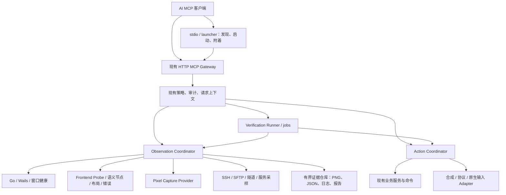

# MCP：AI 真机观测、可靠操作与 UI 渲染诊断重设计方案

日期：2026-11-26。状态：待评审设计，**不是已实现功能说明**。

本次工作包括当前源码审计、Wails 3.1.0 官方实现调查、当前 macOS 运行实例的只读 MCP 探测。本轮新增本方案和探测记录，保留工作区已有改动；未修改应用实现、连接保存的远端服务器或执行业务写操作。

## 1. 设计结论与目标

建议保留现有 MCP、HTTP、stdio、业务服务、授权和 jobs，新增统一的**发现与连接、运行态观测、真实像素采集、渲染诊断、可靠交互、验证编排**六个部分。

现有 MCP 的主要问题是证据链不完整：工具可以调用、业务状态可以读取，但 AI 还不能稳定地回答“我连接的是哪一版应用、当前窗口实际显示什么、哪里显示异常、操作是否真的生效、失败在哪一层”。

推荐的默认流程：

```text
发现/启动正确实例
  → 校验实例、构建和平台能力
  → app.observe：先看服务、前端和当前画面
  → ui.inspect / ui.diagnose：按问题深入
  → 语义业务工具或 ui.act：执行操作
  → ui.wait：等待明确条件
  → 再次观测：验证业务结果和真实画面
  → 输出含截图、步骤、状态和覆盖范围的验证报告
```

这里的“服务状态”包含两部分：ding-ssh 应用自身的后端、WebView 和窗口；通过 SSH/SFTP/隧道访问的目标服务。二者分别判断，不能用本机 HTTP 端口正常推断远端业务健康，也不能用 SSH 连接正常推断页面正确渲染。

核心验收目标：

1. AI 无需猜端口、猜窗口标题、猜 CSS class，就能连接指定应用实例并知道实际能力。
2. AI 一次调用能得到当前窗口原始截图、可操作节点、最重要的异常和证据缺失项。
3. UI 问题能定位到区域、元素、组件以及具体几何/样式/字体/终端渲染证据。
4. 每个动作能区分“已经接收”“已经派发”“界面稳定”“预期结果得到验证”。
5. 前端白屏、卡死或桥接失联时，后端仍能返回诊断和部分证据。
6. 真机验证报告明确机器、版本、输入方式、截图来源、远端目标和未验证部分。

## 2. 当前实现：已经有很多能力，缺少可靠的统一入口

### 2.1 可以直接复用的部分

2026-11-26 当前运行实例通过 MCP 实际发现 **124 个工具，其中 25 个 ui.* 工具**。

| 范围 | 已有能力 | 本次处理 |
| --- | --- | --- |
| 接入 | Streamable HTTP、SSE、stdio 代理、debug.json、重读发现文件 | 保留，补实例身份、启动和 ready 闭环 |
| 应用操作 | 服务器、分组、凭据、隧道、设置、标签、面板、分屏、应用命令 | 保留，作为语义动作主通道 |
| SSH | connect/wait/reconnect/disconnect、信任 challenge、PTY、独立 exec | 保留，接入统一状态与验证场景 |
| 任务 | jobs 状态、输出游标、取消、幂等、并发和持久摘要 | 复用，不再开发第二套任务存储 |
| 远端状态 | 主机指标、进程、systemd 状态和日志、隧道运行信息 | 保留，补采样来源与端到端探测语义 |
| 文件 | SFTP 读写、补丁预览、原子覆盖、条件写、分片上传下载 | 保留，验证时用临时目录与回读哈希 |
| UI 事实 | layout/query/styles/tokens/hit/tree/console/revision/assert/store | 保留兼容，统一归入 observation |
| UI 图像 | screenshot/elementShot/snapshot/diff | 复用裁剪、图像返回、存档和差异算法，替换采集底座 |
| UI 动作 | navigate/window/reload/click/type/key/hover/scroll | 保留兼容，新增语义定位、可操作性与动作后验证 |
| 性能 | Go heap/goroutine/RSS/CPU、前端延迟、WebGL/DOM、终端输出积压 | 直接接入观测，不重复采集 |

旧文档中的 98 个工具是历史数据。exec/jobs/services/metrics 等已经实施，本方案不把它们重复列为新功能。

### 2.2 源码与实机发现

以下路径相对仓库根目录；行号对应本次审计时工作区。

| 优先级 | 发现与证据 | 造成的问题 | 重设计措施 |
| --- | --- | --- | --- |
| P0 | internal/debugsrv/screenshot_other.go:12 非 Windows 直接报不支持；macOS 实测失败 | 当前机器没有 MCP 真实像素能力 | 补 macOS capture provider，统一三平台接口 |
| P0 | frontend/src/main.ts:14 异步 mount，:19 提前 installDebugUI；debug/ui.ts:274 找不到 Vue app 就返回 | Vue 渲染错误可能未被捕获；不是“没有错误” | createApp 后、mount 前显式安装 app 级错误钩子 |
| P1 | debug/ui.ts:640 依赖 Vue 私有 app._instance；macOS 实测 ui.tree 失败 | 目录中存在的能力在实际包中不可用 | 显式组件探针注册，避免依赖私有根字段 |
| P1 | debug/ui.ts:214 只保存日志参数类型/长度，丢弃 message/stack | AI 无法定位报错文件、组件、原因 | 专门的结构化诊断事件和受控细节读取 |
| P1 | internal/apphost/debug.go:348 的 app.health 是版本/目录/权限摘要 | 端口能响应被误当成整个应用健康 | 分层健康、心跳、桥接 RTT、渲染状态 |
| P1 | internal/debugsrv/ui.go:2792 只比较 revision/view；失败五次自停 | 同页弹层、布局、字体、错误变化不被通知 | 页面代次与多种变化序号；监控监督恢复 |
| P1 | debug/ui.ts:328 只读 9 个固定布局区域 | 不能发现大量文本、字体、画布与交互问题 | 页面契约 + 有界规则扫描 + 图像证据 |
| P1 | debug/ui.ts:1209 selector 直接派发事件 | 被盖住的按钮也可能“点成功” | actionability、hit-test 和真实输入适配 |
| P1 | UI 动作没有统一等待绘制/业务条件 | 事件派发返回被当成执行完成 | 显式完成阶段和后置条件 |
| P1 | ui.go:1940 指纹/几何/图像分次采集 | 截图与 DOM 可能不是同一状态 | 一致性窗口、前后序号校验、有限重试 |
| P1 | debug.go:112 只分配 CDP 端口，未配置 WebView2 启动参数 | discovery 有端口不代表能连接 | requested/configured/reachable/targetMatched/ready 分开报告 |
| P2 | Windows screenshot_windows.go:69 通过固定标题找窗口 | 多实例/标题变化可能截错 | Wails windowId → 原生句柄映射 |
| P2 | runtime-status.ts:8、app.go:1352 的指标未整合进 MCP | 卡顿、积压线索散落在日志与关于页 | 汇总进 app.observe/terminal 诊断 |

当前只读探测记录见 [mcp-observability-probe-2026-11-26.json](validation/mcp-observability-probe-2026-11-26.json)。实测结果：

- 初始化协议 2025-06-18 成功；124 个工具、25 个 UI 工具。
- ui.revision 和 ui.layout 正常；layout 返回 9 类关键区域。
- ui.tree 返回“#app.__vue_app__._instance 不可用”。
- ui.screenshot 返回“窗口截图目前仅支持 Windows”，同时错误提示仍建议 restore；应按错误原因返回可行建议。
- app.health 没有 frontend ready、渲染健康或组件健康字段。
- ui.console 本次没有错误条目；鉴于捕获缺口，不能据此证明没有 Vue 错误。

运行实例未提供足够构建身份，本次不能证明它与当前全部未提交源码逐字一致；源码审计与运行时事实分别保留。

## 3. Wails 3 到底提供了什么

### 3.1 结论：有官方 MCP，但不能直接满足视觉验收

项目依赖 github.com/wailsapp/wails/v3 **v3.1.0**，前端 runtime 也是 3.1.0。以下以该固定版本源码和官方文档为依据。

Wails 内置 MCP 使用 `mcp` build tag，文档标记为 experimental。它提供 16 个工具：

| 类别 | 官方工具 | 可利用的能力 |
| --- | --- | --- |
| 应用/窗口 | app_info、windows_list、window_control | 窗口枚举、位置、尺寸、焦点、显示/隐藏、最小化、缩放、重载等 |
| DOM | dom_html、dom_query、screenshot_dom | DOM 查询、可见元素、bounds、焦点和滚动状态 |
| JS | js_eval | 当前 WebView 内异步执行并回包 |
| 输入 | mouse_move/click/drag/scroll、keyboard_type/press | 页面内合成事件与部分手动默认行为 |
| Go/事件 | call_bound_method、emit_event、wait_for_event | 调用绑定方法、事件发送和等待 |

**screenshot_dom 的定义明确是 “DOM-based, no pixels”。** 它没有返回真实截图，无法验证实际字形、图标缺字、canvas/WebGL 画面、GPU 合成、毛玻璃和最终视觉遮挡。

官方输入主要是 dispatchEvent 等合成操作。它可以测试事件处理，却不等同系统输入；CSS :hover、真实 Tab/编辑默认行为、用户手势、IME、原生菜单和文件对话框需要额外验证。

另一个命令 `wails3 mcp` 管理项目构建、dev 进程、doctor 和任务，属于开发生命周期服务，不能与运行中桌面应用的 UI MCP 混为一谈。

### 3.2 可以复用的公共接口

| Wails 接口 | 使用方式 | 边界 |
| --- | --- | --- |
| WebviewWindow.ExecJS | 前端探针执行/采集；沿用 requestId 回包桥 | 本身不是同步取返回值接口 |
| WebviewWindow.NativeWindow | 映射 HWND、NSWindow、GTK window | 原生窗口句柄不是 WebView2/WKWebView 对象 |
| Window 管理与事件 | 多窗口 registry、可见性、焦点、尺寸、生命周期 | 能读窗口状态不代表它完成绘制 |
| WindowsOptions.AdditionalBrowserArgs | Windows 注入 remote-debugging-port | 需要实际探测端口并匹配当前 target |
| application.Options.Logger | Wails 系统日志接入统一诊断 sink | 仍需诊断投影与预算 |
| OpenDevTools | 开发排障入口 | production 构建可能是 no-op；不能作为 AI 自动化基础 |

macOS 使用 WKWebView，Linux 使用 WebKitGTK，不能假设三平台都支持 Chromium CDP，也不能统一承诺 Playwright connectOverCDP。

### 3.3 集成决策

**ding-ssh 现有 MCP 保持正式统一入口。** 复用 Wails 公共接口及官方实现思路，缺失部分由本项目 adapter 实现；官方第二套 MCP仅作为独立开发诊断 profile。

理由：官方服务会额外启动 listener，任意 js_eval/call_bound_method/emit_event 不会自动经过本项目的能力、客户端范围和审计。直接同时开启会形成两套实例、工具和状态来源，并不能补上真正像素。

本仓 Taskfile 自定义 TAGS，未合并 Wails CLI 的 EXTRA_TAGS。若需要官方 MCP 诊断 profile，必须先调整标签合并并实测 listener/tools，不能仅凭 `WAILS_MCP=1` 声称已开启。

官方固定版本资料：

- [3.1.0 release](https://github.com/wailsapp/wails/releases/tag/v3.1.0)
- [MCP 指南](https://github.com/wailsapp/wails/blob/v3.1.0/docs/mpress/content/guides/mcp-service.md)
- [工具实现](https://github.com/wailsapp/wails/blob/v3.1.0/v3/pkg/application/mcp_tools_enabled.go)
- [页面注入与输入实现](https://github.com/wailsapp/wails/blob/v3.1.0/v3/pkg/application/mcp_inject.js)
- [窗口公共接口](https://github.com/wailsapp/wails/blob/v3.1.0/v3/pkg/application/webview_window.go)
- [应用选项](https://github.com/wailsapp/wails/blob/v3.1.0/v3/pkg/application/application_options.go)

## 4. 总体架构



职责约束：

- Gateway 继续负责 MCP/HTTP/资源/鉴权，不负责平台截图实现。
- Coordinator 组合观测和动作，不复制 SSH/SFTP/设置业务。
- Probe 只返回页面事实；布局规则和 AI 视觉判断使用这些事实，分别记录判断来源。
- Pixel provider 只承诺实际捕获到的 surface 与能力，不静默改变截图语义。
- Runner 使用相同工具和服务路径，不通过第二条隐藏通路制造“测试通过”。

## 5. AI 自己连接：发现、启动、附着、就绪

### 5.1 当前不足

stdio 已支持读取 debug.json 和应用重启后的重连，但应用没启动、发现文件过期、端口被占用、前端没 ready 时，缺少完整引导。

建议增强 `ding-ssh-mcp`，加入本地 launcher 模式。启动应用是 launcher 的职责，因为应用没运行时不存在可接收 bootstrap 工具的 MCP 服务。

以下名称是**拟新增选项**，当前不能直接使用：`--launch=if-needed`、`--app-path`、`--profile`、`--instance`、`--wait-ready-ms`。

### 5.2 状态机

```text
discovering → validating → attaching → waiting_backend → waiting_frontend → ready
                    ↘ launch_required → launching ↗
失败：not_installed / stale_discovery / instance_mismatch / launch_failed /
     backend_timeout / frontend_timeout / permission_required / build_mismatch
```

具体行为：

1. 发现文件包含 schemaVersion、instanceId、PID、进程启动标识、启动时间、appVersion、buildId、后端/前端构建身份、profile、transport、window IDs、最后更新时间。
2. 验证 PID/启动身份、endpoint challenge 和 instanceId；PID 相同不足以防止复用误认。
3. 明确匹配目标：已运行的用户实例、指定安装包，或隔离验证实例。多个候选必须返回候选和需要明确的目标，不能按窗口标题随便选。
4. 仅在明确允许 launch 的配置下启动指定可执行文件，不把任意 shell 当启动器。
5. 等后端监听，再等 frontend ready 握手、窗口出现和首份 observation；返回每一阶段耗时。
6. 应用重启后 token/instanceId/pageEpoch 变化，重新初始化；清除旧 nodeRef。不能重放状态未知的写动作。
7. stderr 输出可读进度与错误；stdout 仍严格只输出 MCP 消息。

隔离验证继续复用 `DING_SSH_DEV_CONFIG_DIR`，还要检查 SingleInstance 唯一标识。当前 main.go 使用固定 UniqueID，隔离 profile 必须与日常实例区分，否则启动测试包可能把请求交给已有旧实例。

日常实例的调试开关关闭时，launcher 返回 `DEBUG_DISABLED` 及可信配置入口，不偷偷打开。隔离验证实例则必须在启动前 provisioning：由受控 launcher 在新的测试配置目录通过现有 store 逻辑预置 Enabled、loopback/动态端口、限定测试策略和客户端身份；不能直接修改用户数据库或借用日常实例 token。启动后的发现文件通过受限本机通道提供本次实例凭据，后续按既有客户端注册流程建立验证身份。已有明确授权的开发验证范围可以复用，不要求 AI 每一步重新取得同一授权。

首次 provisioning 与实例启动的边界是“只创建当前验证 profile 所需配置”；不含读取/复制用户密码、自动接受远端指纹或授予未请求的业务权限。需要真实目标时使用现有保存凭据的内部使用能力或用户预置测试身份。配置未就绪时返回 `PROVISIONING_REQUIRED`，不进入永远无法完成的 ready 等待。

### 5.3 防止“测了旧包”

每次报告记录 backendBuildId、frontendBuildId、gitCommit、dirty 标识和受控源码/资产 manifest digest。生产内嵌资产可以匹配构建 manifest；Vite/HMR 场景标记 dev + assetEpoch，而不是假装有固定 bundle。

前后端版本不匹配、测试要求的构建不匹配，应返回 BUILD_MISMATCH。可以继续诊断，但不得生成“当前改动验证通过”的结论。

## 6. 统一能力与健康模型

### 6.1 能力可用性与健康分开

`app.runtimeCapabilities` 提供运行时可用性；已有 app.permissions 继续描述调用身份的授权。

| 模型 | 状态 | 例子 |
| --- | --- | --- |
| 能力可用性 | available / unavailable / permissionRequired / unsupported | 截图 adapter 已初始化；缺系统权限；该平台不支持 |
| 组件健康 | healthy / degraded / unhealthy / unknown | 后端正常；字体回退；桥接超时；没有新样本 |
| 验证结果 | passed / failed / inconclusive / skipped / cancelled | 业务与视觉断言通过；缺原生证据而无法下结论 |

能力条目至少含：provider、surface、supportedOperations、limitations、probeAt、reasonCode、nextAction、所需权限。实际调用仍重新验证可用性，不把启动时一次探测当永久保证。

### 6.2 健康分层

| 层 | 观测内容 | 典型故障 |
| --- | --- | --- |
| 进程/宿主 | uptime、CPU、RSS、heap、goroutine、主窗口生命周期 | 泄漏、进程仍在但主线程不响应 |
| MCP | 请求延迟、活动调用、队列、SSE 丢失/重连 | listener 正常但请求积压 |
| Wails bridge | ready、往返延迟、超时、pending 数、最后成功 | 事件未监听、页面重载、主线程堵塞 |
| 前端运行时 | JS 心跳、event-loop delay、错误、组件 mounted 状态 | 白屏、Vue 渲染异常、Promise 拒绝 |
| 显示/绘制 | window visible/minimized、frame progression、布局稳定、资源加载 | 窗口隐藏、字体失败、GPU/画布异常 |
| 终端流水线 | backend read、送达、write parsed、rendered、积压、fit/resize | 有 SSH 输出但画面没更新 |
| 连接/传输 | 连接阶段、challenge、transport epoch、SFTP/传输、隧道 | 握手中、认证失败、断线、传输停滞 |
| 目标服务 | 已有服务状态、日志、显式 TCP/HTTP/端到端探测 | 进程在但端口不可达，隧道存在但目标失败 |

每一项都附 observedAt、ageMs、source、latencyMs、errorCode 和适用范围。采样缺失返回 unknown；未启用某个可选能力不应直接把整个应用判 unhealthy。

`app.observe` 可按本次 scope 给总状态，但必须同时保留 coverage。例如 `healthy + coverage.partial` 只说明已覆盖的关键项健康，不能表达“全部通过”。

### 6.3 心跳与失联

- 正常可见窗口，前端约每秒发轻量心跳；宿主记录接收时间和 pageEpoch。阈值可配置，初始以 3 秒可疑、10 秒失联作为待调优值。
- 宿主独立检查心跳年龄；JS 卡死时不依赖 JS 报告自己卡死。
- 后台、最小化、系统休眠会节流定时器，结合可见性和系统事件判断 suspended/unknown，避免误报。
- bridge 使用独立短 ping 与 RTT，完整观测有总预算；前端不可达不阻塞所有后端状态。
- watcher 出错后退避并监督重建；恢复产生 frontend.recovered，旧证据标过期。
- 不能通过修改原生窗口必须运行的 UI 线程来强行“解卡”；截图超时应独立返回。

## 7. 新的 AI 工具入口

默认使用高层入口，现有 124 项保留兼容、作为深入控制和业务工具。无需让 AI 每次拼十多个低层工具。

| 新入口 | 核心参数 | 返回与用途 |
| --- | --- | --- |
| app.runtimeCapabilities | 可选 windowId | 实际 provider、能力、限制和缺失原因 |
| app.observe | scope、windowId、detail、includeImage、budgetMs | 应用与目标状态、当前 UI、一张缩略图、主要 issues、coverage |
| app.diagnostics | observationId/operationId、sections、cursor | 下钻错误、日志、桥接、会话与性能证据 |
| ui.observe | windowId、scope、settle、imageMode | 同一证据组内的真实图、语义节点、诊断摘要 |
| ui.inspect | observationId、nodeRef 或 locator、sections | 盒模型、样式、裁切链、堆叠、命中、组件和资源 |
| ui.diagnose | observationId 或 fresh、scope、rules、budgetMs | 有界规则报告与局部证据 |
| ui.act | observationId、nodeRef/locator、action、params、inputMode、wait | 动作阶段、效果断言、操作后 observation |
| ui.wait | windowId、condition、timeoutMs、stableForMs | 条件是否达成、pending、最后状态与图 |
| ui.compare | baselineId、currentId、masks、tolerances | 像素/语义/布局差异及是否可比 |
| targets.probe | sessionId/tunnelId 或受限 targetRef、kind、executionPoint、timeoutMs | 明确视角的 TCP/HTTP/TLS/隧道端到端探测 |
| verify.run | scenarioId、target、parameters、profile | 立即返回 jobId，后台运行场景 |
| verify.get | jobId、cursor | 场景步骤、证据、断言、覆盖和清理结果 |

verify 的状态、取消和输出复用 jobs 引擎；扩展 job kind 和结构化步骤事件，而不是复制一套 executor。长验证不占住一个长 HTTP 请求。

工具组索引可通过 MCP resources 提供 `app://automation/overview`、`app://automation/scenarios`、`app://automation/capabilities`；大产物用有权限的 resource/artifact ID 读取。工具目录保持稳定，运行时能力另查，避免客户端缓存混乱。

### 7.1 observation 最小契约

下面是**设计示例，非当前实测结果**。真实图片通过 MCP image content 返回，JSON 只存引用。

```json
{
  "schemaVersion": "1",
  "observationId": "obs-001",
  "instanceId": "instance-abc",
  "build": {"backend": "build-a", "frontend": "build-a", "mode": "production"},
  "surface": {"windowId": "main", "pageEpoch": "page-xyz", "kind": "webview"},
  "capturedAt": "2026-11-26T12:00:00+08:00",
  "health": {"state": "degraded", "coverage": "partial"},
  "view": {"name": "workspace", "dialogs": [], "activeSessionId": "session-1"},
  "viewport": {"cssWidth": 1280, "cssHeight": 800, "dpr": 2, "uiScale": 1.25},
  "sequences": {"mutation": 52, "layout": 38, "paint": 16, "errors": 2},
  "capture": {
    "artifactId": "image-001",
    "provider": "macos-wkwebview",
    "surface": "webview",
    "pixelWidth": 2560,
    "pixelHeight": 1600,
    "consistency": "stable-window",
    "occlusionPossible": false,
    "transform": {"scaleX": 2, "scaleY": 2, "offsetX": 0, "offsetY": 0}
  },
  "stability": {"settled": false, "pending": ["terminal:render-watermark"], "elapsedMs": 1200},
  "nodes": [{"ref": "n23", "role": "button", "name": "重连", "actionable": true}],
  "issues": [{"issueId": "issue-2", "ruleId": "terminal.gridMismatch", "certainty": "candidate", "nodeRef": "n42"}],
  "coverage": {"dom": "complete", "pixels": "complete", "nativeChrome": "notRequested", "remoteService": "notSampled"},
  "nextActions": [{"tool": "ui.inspect", "args": {"observationId": "obs-001", "nodeRef": "n42"}}]
}
```

app.observe 和 ui.observe 使用同一 observation 数据模型；前者额外聚合宿主/远端信息，后者集中在目标 surface，避免两个实现产生相反事实。

### 7.2 AI 一眼看到什么

默认响应按以下顺序组织：

1. 原始当前画面，长边默认约 1440px，完整分辨率通过 artifact 可取。
2. 简短状态：“后端正常；前端响应正常；终端区域存在 1 个尺寸异常候选；字体回退 1 项”。
3. 最多 5 个重要问题，每项有编号、区域、规则证据和局部截图引用。
4. 最多约 100 个当前可见可操作节点，ref 与截图标注可对应；超限明确截断与分页。
5. 未覆盖项：“原生标题栏未采集”“远端服务本次未探测”“图像与 DOM 一致性未确认”。

保留原始图；按需返回编号标注图和裁切图。这里“原始图”指未加诊断标注、但已按当前授权执行必要遮罩的图；不代表无条件导出全部原始像素。不能只返回满屏框线图，因为标注可能挡住字体、边框和细小错位。

“一眼看出”由真实图像、可定位事实、规则候选共同实现。程序不承诺自动判断所有美观问题；AI 的视觉判断作为单独 evidence type，不能伪装成确定性规则结果。

## 8. 真实截图：优先补 macOS，统一 surface 和坐标

### 8.1 三种截图必须区分

| surface | 要检查什么 | 局限 |
| --- | --- | --- |
| webview | 页面内容、canvas、字体、图标、内部弹层 | 不覆盖原生窗口边框和完整桌面合成 |
| native-window | 窗口自身内容和原生装饰 | 透明/毛玻璃是否含真实桌面背景由 provider 声明；离屏窗口图不一定等于桌面最终合成 |
| desktop-crop | 实际桌面上用户看到的窗口区域 | 可能有其他窗口遮挡；通常需要额外系统权限 |

DOM 树和 DOM 重绘不能标成上述真实像素。provider 失败时可以显式降级，但必须改写 surface/source/limitations。

### 8.2 平台实现路线

| 平台 | 首选内容截图 | 整窗口方案 | 关键限制 |
| --- | --- | --- | --- |
| macOS | 自研 Objective-C/cgo adapter，通过受支持方式定位 WKWebView，调用公开 takeSnapshot | ScreenCaptureKit/兼容窗口捕获 adapter | Wails 没公开 WKWebView 指针；需要探针验证、上游扩展或窄范围桥接；系统捕获权限独立报告 |
| Windows | 真正配置并验证 CDP，匹配本实例 target，Page.captureScreenshot | 当前 Wails HWND + 原生 capture provider，复用 PrintWindow 作为一条路径 | GPU 合成可能出现空白；CDP 捕获不等于原生组合；不能按标题找窗口 |
| Linux | WebKitGTK snapshot adapter，分别处理 GTK3/GTK4 | X11/Wayland 对应 adapter；Wayland portal | 桌面会话与权限差异较大，不保证无交互捕获 |

macOS 的实现先做最小 spike：验证当前 Wails 3.1.0 的窗口结构中能否稳定获得目标 WKWebView、主线程调度、Retina、透明背景、xterm WebGL 和隐藏窗口行为。优先向 Wails 补公共 capture 接口；必要时使用本项目窄适配层并锁定版本测试。不使用私有 KVC 字段作为长期基础。

spike 有明确决策出口：若当前版本无法稳定取得公开 WebView 入口，先选窄范围 Wails 扩展；若需要更长上游周期，则以可验证的 native-window provider 交付并声明系统权限、surface 和合成限制。不能无限等待上游，也不能把 fallback 窗口图标成 WKWebView 内容图。

Windows 后续可评估 WebView2 CapturePreview，Linux 可使用原生 WebKit snapshot。Wails 当前未公开对应 WebView 对象，这些都属于拟自研适配路径，不能写成现成可调用的 Wails API。

所有 provider 需要处理：context deadline、并发限制、UI 线程调度、销毁竞争、尺寸上限、PNG 内存预算。调用超时后必须标记取消语义，不能任由重复请求无限积累 native 回调。

读取截图默认不抢焦点、不自动恢复最小化窗口。确需前台/恢复才能采集时返回原因，由已获 UI 操作授权的显式动作处理；不能沿用旧 BitBlt fallback 中隐藏的 SetForegroundWindow 副作用。

### 8.3 坐标契约

- node rect 使用视口 CSS px；图像使用 bitmap px；原生输入使用对应 OS 的屏幕/窗口坐标。
- 每次采集返回明确变换与 client content 原点、DPR、Wails zoom、应用 uiScale、窗口边框偏移。
- uiScale 可能已体现在元素几何中，不能盲目再乘一遍。
- 多显示器、负屏幕坐标、跨屏 DPI 切换必须重新标定。
- scaleX/scaleY 根据实际 bitmap 和 content rect 校准；DPR/Wails zoom 是辅助元数据，不直接连乘猜测。部分截图 API 指定输出尺寸会重采样，变换必须包含这一步。
- 存在 CSS transform/zoom 时使用实际 DOM quad 或注明矩形近似；裁切和点击共享同一变换实现。
- 使用当前 instanceId/windowId/native handle 关联；窗口重建后旧 handle 与 nodeRef 立即失效。

### 8.4 截图是否有效

返回 captureStatus、provider、surface、pixelSize、duration、visibility、occlusionPossible、consistency、reasonCode。全黑、全透明、连续不变只能生成候选，不能简单判定捕获失败：黑色终端本来就可能是合法内容。

验收用受控彩色/文本/canvas 探针和已知区域验证 provider，而不是只检查 PNG 文件能解码。

## 9. 观测一致性与“等页面画完”

### 9.1 生命周期与序号

- instanceId：一次宿主进程。
- windowId：稳定的逻辑窗口；native generation 区分重建。
- pageEpoch：页面完整加载/重载；HMR 还需 assetEpoch。
- mutationSeq：有意义 DOM 变化；排除探针自身标注。
- layoutSeq：区域几何变化；字体、缩放、窗口 resize 等都可触发。
- paintSeq：应用/终端绘制探针水位，表示观察到的进展，**不宣称等于显示器真实呈现帧号**。
- errorSeq、requestSeq：新增错误和请求生命周期。

MutationObserver、ResizeObserver、字体事件、Vue/业务 loading、xterm 事件联合上报；持续输出和动画按区域聚合。默认限频合并到约 4Hz、心跳约 1Hz，不能把每个字符绘制变成 SSE 消息。

### 9.2 统一采集协议

1. 读宿主状态和前端 ready；指定 window/page/scope。
2. 对请求范围等待 Vue nextTick、连续 rAF、几何 quiet window、相关资源和业务条件。
3. 一次前端回包采集语义节点、几何、样式摘要和起始序号。
4. 捕获真实像素；记录采集起止时间。
5. 再读关键序号与区域摘要；变化时最多重试两次，受总 budget 限制。
6. 返回 stable-window / changed-during-capture / unknown，以及各证据的时间范围。

DOM 与原生像素不可能保证全平台绝对原子，因此用“一致性窗口”表达实际保证。持续变化时照样返回当前图和 partial 事实，不无限等待，也不谎称稳定。

### 9.3 wait 条件

支持组合 all/any：view/section、节点 visible/hidden、text、dialog closed、业务 loading、指定 request 完成、font ready、layout stable、session connected、terminal watermark、服务断言。

默认等待策略是局部范围，而不是全局 network idle 或全页面静止。SSH 流、SSE、终端持续输出和状态栏指标不能永久阻止按钮操作。

初始建议：局部布局连续 200ms 无关键变化、至少两次 rAF；单动作默认 5 秒、上限 30 秒，长业务转 job。具体阈值通过真机数据调优。超时返回 unmetConditions、lastObservation、pending，不只返回“timeout”。

## 10. 让 AI 定位到 UI 渲染问题

### 10.1 规则输出

每个 issue 包含 ruleId、severity、certainty（fact/candidate）、nodeRef、component、CSS rect、证据值、截图区域、相关变化和建议下钻。无法检查的规则返回 skipped/unsupported 及原因。

规则集合分层：

| 规则组 | 检查内容 | 判定注意事项 |
| --- | --- | --- |
| 页面骨架 | 当前 view 必需区域缺失、零尺寸、意外空白、loading 长期不结束 | 用页面契约区分正常空状态和白屏 |
| 裁切/滚动 | 祖先 overflow 裁切、视口外弹层、滚动不可达、水平溢出 | intentional ellipsis、折叠、虚拟列表可声明例外 |
| 遮挡/交互 | hit-test、点击点被盖、inert/disabled、modal 层级、焦点落背景 | 使用实际命中链；矩形相交只作线索 |
| 文本/字体 | Range 几何、scroll/client 尺寸、行高、字体加载失败、回退、缺字候选 | FontFaceSet ready 不证明每个字形正确；结合应用字体元数据和截图 |
| 图标/资源 | 图片失败、naturalWidth=0、资源错误、未解析 token、关键图标缺失 | 跨域/隐私限制需要 coverage 说明 |
| 主题/布局 | token 生效、布局约束、窄窗、高 DPI、缩放、暗亮主题 | 对比度复杂背景和毛玻璃只能部分估算 |
| 终端 | 网格/容器/canvas/DPR、fit、PTY resize、输出水位、WebGL context | 专用探针，不能仅靠 DOM 盒子 |
| 性能 | 主线程延迟、长任务、布局抖动、积压增长、帧无进展 | API 不支持或后台节流不能伪造数值 |
| 可访问性 | role/name、label、焦点顺序、可触达、dialog 语义 | 初版为应用语义树，不宣称完整系统 AX tree |
| 图像候选 | 局部全黑/空白、元素错位、文字视觉异常、差异热点 | 交给 AI 结合原始图确认 |

### 10.2 页面契约

为 home、servers、workspace、tunnel、settings 各 section、unlock 和主要 dialog 注册契约：

- 当前页面必须存在的区域及可选区域。
- loading/empty/error/ready 各状态应出现什么。
- 关键可操作节点和稳定 automation ID。
- 允许的滚动/裁切、预期 overlay 和尺寸约束。
- 与后端业务对象的关联，如 sessionId、transferId。

规则例外需要局部声明、理由与可检索位置；不能简单把所有浮层重叠都当 expected。

### 10.3 组件和源位置

不把 app._instance 当正式接口。启动时显式传入 Vue app 安装错误钩子；通过轻量 probe registry 登记诊断组件的 ID、显示名、挂载状态、DOM 根和安全状态摘要。

开发构建可用额外组件/源码映射；生产构建保留白名单 probe 与 build manifest。不要为了组件树给所有正式包打开 Vue 私有 devtools 数据。

错误使用 buildId + JS frame + 可用 source map 关联源码；发布包不一定附带完整源码，映射失败时明确返回编译后位置。

### 10.4 终端专项：从“收到输出”到“画到屏幕”

扩展现有 debug registry 和 runtimeStatus，复用 TerminalView.renderDiag/fit/字体状态：

```text
backendReadSeq → eventDeliveredSeq → xtermWriteSeq → writeParsedSeq → renderObservedSeq
                                                ↘ pendingBytes / oldestPendingAge
```

记录 rows/cols、cellWidth/Height、容器和 xterm screen/viewport、canvas CSS 与 bitmap 尺寸、DPR/zoom、renderer、font load generation、最近 fit、最近 PTY resize 提交与确认。

重点规则：

1. rows × cellHeight 与可用内容高度明显不符。
2. canvas bitmap 与 CSS/DPR/zoom 不一致。
3. 字体替换之后没有重新 fit/resize。
4. buffer 有新输出但 write/render 水位长时间不前进。
5. WebGL context lost、回退未完成或 renderer 与设置不符。
6. 顶部/底部可见行、scrollback 与实际滚动区域不一致。

xterm 内部私有网格信息集中在版本适配器，不能分散读取；升级 xterm 时运行契约验证。最终视觉仍需要真实图像，水位不能证明 GPU 最终像素完全正确。

## 11. 可靠操作：定位、执行和效果验证

### 11.1 定位顺序

优先 observation 内 nodeRef，其次 role + accessible name + scope，再次稳定 data-automation-id；CSS selector 保留作高级兼容。业务实体使用稳定 ID，避免依赖中文、英文、class、nth-of-type 或列表索引。

nodeRef 绑定 instance/window/pageEpoch 与当前元素身份。布局变化不必让所有 ref 失效，但动作前重新验证目标仍连接、语义一致与位置；元素被替换、重载、跨窗口时拒绝 STALE_TARGET，返回新的 observation。

### 11.2 可操作性检查

默认要求唯一目标、连接到 DOM、可见、有有效尺寸、未 disabled/inert、滚入视口、位置稳定、至少一个安全点击点命中目标/合法后代。失败返回多匹配、遮挡元素、裁切链或具体原因。

不能 selector 直接 dispatch 后就说“用户可以点到”。force 操作如需提供，应显式标注绕过了哪些检查，不用于正常 UI 可用性验收。

### 11.3 三种执行后端

| inputMode | 使用场景 | 能证明什么 |
| --- | --- | --- |
| semantic | app.command、sessions、settings、SFTP 等现有业务接口 | 业务服务执行与结果，仍需补 UI 观察 |
| dom-synthetic | 组件事件、普通输入的快速联调 | 页面事件处理结果；不证明完整原生输入 |
| protocol / native | Windows CDP 或平台原生输入 adapter | 对应平台支持范围内的真实交互路径 |

响应报告实际 inputMode、trustedEvent、provider、支持限制。CDP、原生事件的 trusted 属性与用户手势能力按实际结果报告，不能统一假设。

hover、Tab、快捷键、拖拽分屏、resize、复制粘贴、IME、原生文件对话框、菜单/托盘分别列入能力和验收矩阵。初版无法操作的原生 surface 返回 unsupported/permissionRequired，不以业务 API 调用冒充原生点击验证。

### 11.4 动作结果

```json
{
  "operationId": "op-17",
  "accepted": true,
  "dispatched": true,
  "settled": true,
  "effectConfirmed": false,
  "inputMode": "dom-synthetic",
  "status": "inconclusive",
  "unmetConditions": ["session.status == connected"],
  "afterObservationId": "obs-002"
}
```

后置条件绑定本次动作相关 request/job/session，防止旧成功状态被误当新动作结果。请求超时但动作可能已发生时，先查 operationId 和当前状态，不自动重放。

并发 UI 写动作按窗口串行化；观测可并发但有预算。检测到用户切页、改焦点或窗口位置时，重新定位或返回 USER_INTERFERENCE，不继续点旧坐标。

## 12. 错误、日志、请求与状态的关联

建立统一上下文：clientId、requestId、operationId、jobId、instanceId、windowId、pageEpoch、sessionId、transportEpoch、observationId。需要跨前后端的字段随 bridge 和业务请求传递。

错误事件至少包含：errorId、code、category、time、buildId、component、source frames、脱敏 message、cause 链摘要、关联 operation，以及采集/脱敏级别。

具体改造：

- 在 mount 前装 Vue app.config.errorHandler，同时保留原处理行为；window.onerror/unhandledrejection 独立采集。
- 资源加载失败使用 capture 阶段 error 监听与字体/图片 registry。
- 前端 Wails service wrapper 记录方法、目标类型、开始结束、耗时、状态码/错误类别；默认不记录完整参数和正文。
- fetch/资源时间只在平台支持时记录；Wails RPC 不一定经 fetch，不能用拦截 fetch 冒充覆盖所有请求。
- Wails Logger、Go 日志、bridge 超时、UI 错误进入同一诊断 timeline，保持有界缓冲和采样。
- 普通 console 维持安全摘要；专用诊断保留白名单字段。受控开发诊断模式可读更多脱敏栈，禁止恢复任意对象原样导出。

前端失联时 app.diagnostics 返回最近心跳、最后截图、宿主状态与缺失原因；旧图必须带年龄与 stale 标记。新原生截图即便可以取得，也可能只是冻结画面，不能说前端已经恢复。

## 13. “全方位”业务状态覆盖表

| 模块 | 需要让 AI 看懂的事实 | 验证方式 |
| --- | --- | --- |
| 启动/解锁 | 启动阶段、锁状态、当前 view、前后端版本、ready | 原生生产包启动，观察空白/错误/解锁界面 |
| 主框架 | 标题栏/侧栏/页签/分屏布局、焦点、窗口状态 | 窄窗、缩放、切页、真实截图 |
| 服务器/分组 | 列表、筛选、选中项、表单校验、提交状态 | 语义 CRUD + UI 回读，使用测试数据 |
| SSH | DNS/TCP/握手/信任/认证/ready 阶段、耗时、challenge、错误 | 授权目标连接、失败夹具、状态和界面同步 |
| 终端 | 后端 PTY 与页面 tab 绑定、输出/渲染水位、字体、网格 | 已知输出、中文/ANSI、resize、滚动与像素 |
| SFTP | 初始化、当前目录、loading/error、列表、传输进度/取消 | 临时文件上传/下载/哈希、UI 列表与传输展示 |
| 系统信息 | 采样时间、权限、数据源、图表更新、字段缺失 | 固定采样与 UI 文本/图表核对 |
| 隧道 | listener、forward 状态、最后错误、字节/连接、目标探测 | 受控 echo/HTTP 端到端，而非只看 active=true |
| 服务 | 当前服务管理器、状态、日志 freshness、探测范围 | 复用 systemd；其他平台分 adapter，未实现明确标记 |
| 主题/字体 | 设置值、实际 token、字体加载/回退、缩放、渲染器 | 亮暗/中文英文/字体失败/100–200%组合 |
| 弹层/命令 | 打开状态、层级、命中、焦点、关闭行为 | hover、Tab、快捷键、弹层边界截图 |
| 凭据/信任 | 是否可用、被锁、需要什么 challenge | 使用状态与错误，不依赖导出明文 |
| 导入导出/更新 | 任务阶段、校验、进度、重启/失败、当前安装版本 | 隔离包/夹具验证；破坏性升级用专用环境 |
| 原生集成 | menu/tray、文件对话框、剪贴板、badge、通知 | 宿主状态 + 原生 adapter；需区分“事件已发”与“系统已显示” |

远端健康探测必须声明视角：本机到目标、SSH 远端内执行、通过隧道、或对应用访问路径的端到端。HTTP 探测返回连接/TLS/状态码/耗时和限定摘要，不默认获取页面正文；TCP 成功不能证明业务内容正确。

新增 `targets.probe`，与现有 `services.status`（服务管理器状态）、`tunnels.health`（运行信息）分工。参数包含：

- `targetRef` 优先引用已授权服务器/服务或本次验证 fixture；通过 `sessionId`/`tunnelId` 固定关联与 transport 代次，不默认开放任意 URL。
- `kind` 为 tcp/http/tls；`executionPoint` 为 local/ssh-remote/tunnel，返回实际 source、解析后目标和探测路径。
- `timeoutMs` 默认 3000、上限 10000；`expectedStatus`/`expectedNonce` 为可选精确断言；响应正文默认不取，诊断摘要有上限。
- URL schema、地址/端口和重定向目标逐次受 scope 校验；不接受来自服务响应的任意跳转作为已授权目标。
- SSH 远端探测使用固定参数编码与受控脚本，不拼接 shell 片段；依赖的 curl/openssl 不存在时返回 unavailable。
- 执行器复用现有独立通道/任务预算；本机网络、远端执行和通过隧道分别检验已有授权，新增探测不会隐含扩权。

结果分开给出 DNS、连接、TLS、协议状态、期望断言、耗时和 unknown 原因。首个实现以受控 TCP/HTTP nonce 夹具为主；TLS 细节与平台依赖按能力声明逐步补充。

第一阶段复用现有 Linux systemd 能力。Docker、Windows service、launchd 等属于后续 adapter，按目标需求补，不为了目录完整而返回伪统一状态。

## 14. 真机验证：可重复场景和证据包

### 14.1 验证层级要明确

每个断言记录执行环境和输入/图像来源：unit、browser-fixture、native-desktop、ssh-fixture、user-target-service。这些是不同证据维度，原生桌面连接 SSH 夹具可以同时具备两类来源。

jsdom 的 bbox mock 不能证明布局；浏览器 Vite 页面不能证明 Wails WebView；本机 PTY 不能证明远端 SSH；测试夹具不能证明用户目标服务。

### 14.2 首批场景

1. **desktop.boot**：启动指定生产包 → ready → 构建校验 → 原生/内容截图 → 主框架契约。
2. **desktop.frontend-failure**：受控 Vue 报错、资源失败、短时主线程阻塞 → 检查独立健康与恢复证据。
3. **workspace.terminal**：打开测试终端 → 输出 nonce、中文/英文/ANSI → 等 write/render 水位 → 目视与网格规则 → resize/滚动。
4. **workspace.split**：两个测试终端 → 四方向分屏/拖拽 → 改尺寸 → 检查容器/PTY/画布一致。
5. **ssh.lifecycle**：连接指定目标 → challenge/认证 → terminal ready → 独立 exec 校验身份 → 断线/重连 → UI 状态核对。
6. **sftp.roundtrip**：测试目录写入随机文件 → 下载哈希 → 列表显示 → 取消受控传输 → 清理与残留报告。
7. **tunnel.e2e**：夹具服务 → 建立隧道 → 从明确视角请求 nonce → UI 卡片/错误状态 → 停止和清理。
8. **settings.appearance**：主题/字体/语言/缩放切换 → 等资源和 fit → 截图/诊断 → 恢复原值。
9. **ui.overlays-input**：命令面板、context menu、tooltip、select、dialog → 遮挡/焦点/边界 → 真实输入路径验证。
10. **app.native-integration**：菜单/托盘/文件对话框/剪贴板等按实际 adapter 能力执行；缺失项明确 skipped/inconclusive。

首批故障注入只在隔离开发/验证 profile 可用，以固定 fixtureId 控制：缺字体、错误 CSS 尺寸、异常组件、断网/认证失败、WebGL 丢失、桥接失联。不能把任意 JS 注入当正式验证唯一方法。

### 14.3 生产构建与平台矩阵

- macOS：当前主机先完成真机验收；测试最低支持版本与较新系统的 capture 差异。
- Windows：真实 WebView2、100/125/150/200% DPI，CDP 与整窗口 provider 分别验证。
- Linux：GTK3/GTK4，X11/Wayland 分项记录；无环境的组合写未测。
- 主题亮/暗、语言中/英、最小窗口/常用窗口、UI 缩放、默认/远程失败字体、WebGL/DOM renderer 使用风险驱动组合，不盲目全笛卡尔积。

### 14.4 报告与清理

每次 run 保存 manifest、机器/系统/WebView/provider 信息、构建身份、场景参数摘要、步骤、状态断言、视觉断言、原图/标注/裁图、相关日志/错误、before/action/after observation、未覆盖项和清理结果。

场景保存原 active view、测试创建资源和可恢复设置；清理只处理自己登记的 ID/nonce，不关闭用户已有会话。清理失败单列 residualResources，不能把“业务验证通过但遗留隧道/文件”隐藏掉。

Runner 在有副作用步骤之前持久化资源 ledger：runId、资源类型/目标、nonce、预期路径/ID、参数摘要、提交阶段、已知结果和清理进度；执行后更新真实 ID。提交结果不明时按 nonce 和限定目标核对，不能猜测资源不存在或自动重新创建。并发改过的设置按版本/值核对后才恢复，避免覆盖用户的新修改。

取消进入 `cancel_requested → cleaning → cancelled/unknown`，在有界清理预算内只处理自身资源。进程重启后沿用 jobs 的 unknown 语义，不自动重放场景；恢复协调器读取 ledger，核对身份、当前权限和目标，再执行安全且可证明归属的清理。目标不可达、归属不确定或需额外授权时保留记录与 residualResources，不能把恢复时“删除可能相关资源”当默认策略。

验证成功的条件是所请求场景的必要断言与证据齐全。API 正常但截图失败应是 inconclusive 或分项通过，不能写“UI 验证通过”。

## 15. 对比、基线和视觉回归

复用现有 ui.diff 像素与指纹逻辑，新增 ui.compare 统一契约：

- 基线绑定平台、WebView、viewport、DPR、uiScale、主题、语言、字体 manifest、renderer 和页面数据 fixture。
- 不同环境先做可比性检查；尺寸不同默认报告 layout-changed/incomparable，不再只裁最小公共区域后给一个貌似正常的差异比。
- 用稳定语义/业务 ID 匹配节点；避免 nth-of-type 漂移造成无意义大差异。
- 支持按稳定节点定义动态 mask：光标、时间、实时指标、进度。mask 与原因写入报告，不自动屏蔽未知差异。
- 输出像素热点、区域图、布局变化、样式变化、文本变化；文字抗锯齿/DPI 采用经校准容差。
- baseline 更新是显式版本操作，不能失败后自动把新图当基线。

首版像素/布局规则负责回归证据；OCR、感知图像相似度和更复杂视觉评分列为后续，不阻塞真实截图和基本闭环。

## 16. 资源预算、权限与降级

### 16.1 有界运行

初始建议值，实施时依据实际内存和延迟调整：

- 轻量 app.observe 默认总预算 3 秒；深诊断默认 10 秒；并行子采集共享 deadline。
- 单窗口同时 1 个截图请求，全应用最多 2 个；相同参数的只读请求可合并。
- 默认 observation 摘要不超过约 64 KiB、100 个动作节点；深扫描最多 2000 个元素并按时间片执行，超过预算明确 partial。
- 每张图设置像素/编码字节上限；原图与缩略图分别保留，不在 JSON 中重复 base64。
- 扩展现有快照预算为统一 artifact store，初始可设 128 MiB/24 小时；客户端隔离、TTL、LRU 与活动验证引用共同清理。旧 64 MiB 快照存量迁移时避免双重无界占用。
- 审计只保存必要元数据；截图和日志正文放独立、有权限的产物仓库。

### 16.2 延续已有授权，不再制造旁路

统一工具继续经过现有客户端和能力边界。图像、语义文本、诊断细节按范围授权；现有完全信任开发授权可复用，常规观察与已授权 UI 动作不新增逐步弹窗。

原生系统可能要求屏幕录制/辅助功能权限，能力模型如实返回 permissionRequired。内部 API 不能代替系统授权，也不把缺权限误判成应用 bug。

截图也可能包含终端秘密。默认对已知 password/secret 控件与声明的敏感区域做遮罩，返回 redactions；终端和任意画布不能保证自动识别所有秘密，按既有读取授权和保留策略处理。遮罩影响的区域不生成“视觉验证通过”。

provider 的未处理字节只在采集管线内短暂存在，未获对应像素读取授权时不能保存为可访问的“原图”artifact。前端失联导致当前敏感区域坐标不可知时，不能沿用旧 rect 并宣称已安全遮罩；应根据该客户端对整 surface 的既有授权返回明确 unredacted 图，或拒绝当前图并给出 REDACTION_UNAVAILABLE。历史图的旧遮罩和 stale 状态单独描述。

### 16.3 降级矩阵

| 故障 | 仍然返回什么 | 不能给出的结论 |
| --- | --- | --- |
| 前端失联 | 后端健康、bridge 状态、最后心跳、可用的原生图与历史证据 | DOM 当前状态、页面可操作 |
| 像素捕获失败 | DOM/布局/错误/性能与失败 provider 原因 | 真实画面正常 |
| 只有合成输入 | 页面事件与业务结果、操作后截图 | 原生 hover/IME/快捷键已验证 |
| 远端不可达 | 本机/UI 状态、连接失败阶段和错误 | 服务停止或数据丢失 |
| 动态页面无法稳定 | 有时间范围的图像与 partial 观测 | 绝对同帧证据 |
| 目标/构建不匹配 | 当前实例诊断、所需目标差异 | 当前改动通过验收 |

## 17. 代码落点与兼容迁移

以下是建议文件职责，按实际实现可合并小模块，避免形式化拆太多层。

| 位置 | 计划变更 |
| --- | --- |
| cmd/ding-ssh-mcp | launcher/discovery/ready/build 校验；保留 stdio 并发与取消 |
| main.go、internal/apphost/desktop.go | window registry、Wails Logger、平台 provider 注入、隔离实例身份 |
| internal/apphost/debug.go | 复用 runtime 状态、独立 health、观测桥、上下文传播 |
| internal/debugsrv/bridge.go | window/page 定向、ready、pending/RTT、结构化错误、取消和迟到响应处理 |
| internal/debugsrv/observe*.go | observation schema/coordinator、能力、部分失败、deadline |
| internal/debugsrv/probes.go、internal/apphost/probes.go | targets.probe 的范围校验、固定探测执行器和分阶段结果 |
| internal/debugsrv/ui.go | 复用图像内容、裁剪、存档、差异；接入 capture 接口 |
| internal/desktopcapture/* | 平台 capture provider；依赖由宿主注入，不再由 debugsrv 自己找窗口 |
| frontend/src/main.ts | mount 前显式安装 Vue app 错误钩子，mount 后 ready |
| frontend/src/debug/{probe,observe,actions,diagnostics}.ts | 分离当前过大的 ui.ts；共享 locator/坐标/观测模型 |
| frontend/src/debug/registry.ts | 组件、窗口和终端探针；HMR 生命周期沿用已有安全注册模式 |
| frontend/src/services/* | Wails/网络请求生命周期，关联 operationId |
| TerminalView.vue、runtime-status.ts | 输出/绘制水位、font/fit/resize、复用性能数据 |
| scripts/audit/* | native 场景 runner、平台矩阵和报告生成 |

迁移方式：

1. 旧工具名字与参数保持可用，新工具独立增加 outputSchema。
2. 旧 screenshot/elementShot/snapshot 底层逐步改用同一 capture provider；新 source/coverage 字段保持可追加。
3. 旧 click/type 等逐步调用共享 action 实现；兼容行为变化必须文档化，不能悄悄把 synthetic 改成抢系统焦点。
4. 现有权限默认值不因新增工具而扩大；新能力从当前已授权范围映射。
5. 清理“read 永远允许”“UI 都只改内存”等过时注释，使目录、真实行为与文档一致。
6. HTTP 和 MCP 使用同一 schema/实现，继续跑目录一致性、SDK HTTP/stdio 兼容检查。

## 18. 实施分期与可验收交付

| 阶段 | 交付 | 退出条件 |
| --- | --- | --- |
| A：观测地基 | instance/build 身份、Vue hook、显式 ready、心跳/RTT、runtime 汇总、错误契约、组件 probe、序号和监控恢复 | 生产构建组件信息可读；注入渲染错误能定位；前端卡住后端仍可诊断 |
| B：当前机器像素闭环 | macOS WKWebView spike 与 provider、window registry、坐标、MCP 原图；固定 desktop.boot + terminal nonce 验证脚本 | 当前真机返回包含 canvas 的内容图并完成首个固定证据报告；Retina/缩放/透明/多实例测试通过；失败语义准确 |
| C：默认观察与 UI 诊断 | app.observe/ui.observe/inspect/diagnose、页面契约、终端专项、证据仓库 | 一次看到当前画面和问题；植入的裁切/遮挡/字体/网格问题有可定位证据 |
| D：可靠操作与附着 | launcher/provisioning、build 校验、语义 locator、actionability、ui.act/wait、用户干预检测、最小 verify runner；macOS click/key 原生输入 spike | 冷启动到报告的单场景闭环；遮挡按钮拒绝；旧 ref 拒绝；动作后业务条件可证实；原生输入具备能力时完成一次用户路径验证 |
| E：场景与跨平台 | 扩展 verify 场景、targets.probe、Windows provider/CDP、Linux adapter、更多原生输入与系统集成 | 每个平台分别有真机报告；未测/不支持项明确；场景清理和断点查询可用 |

开发可将 B 的截图 spike 与 A 并行；C 依赖 A/B；D 的 launcher 可提前。优先完成 macOS 最小闭环，再扩展 native-window、Windows 和 Linux，不把三平台接口数量当第一阶段成果。

阶段 A–D 的最小成品是：**AI 自动附着正确实例 → 一次看见真实画面 → 定位问题 → 操作 → 等结果 → 再看画面并输出证据。** D 先提供 desktop.boot + 一个可恢复 UI 动作的最小报告。原生 click/key 如受系统权限或 adapter 限制，报告明确采用 semantic/dom-synthetic 路径，不称为原生用户输入通过；截图在 Wails 真机采集与输入是否原生是两个独立维度。SSH/传输/隧道验证复用已有业务工具，在 E 系统化组织。

## 19. 测试与最终验收标准

### 19.1 必要测试

- 协议：schema/outputSchema、目录一致、HTTP/stdio、取消、部分结果、截断和稳定错误码。
- 生命周期：真实启动顺序的 Vue 异常捕获、ready 竞态、HMR/重载、组件注销、窗口销毁、监控恢复。
- 观测：sequence 变化、采集中变更、超时、旧图标记、前端失联、并发预算、产物清理。
- 交互：多匹配、隐藏/遮挡/disabled/inert、滚入视口、失效 ref、用户干预、后置条件和未知结果不重放。
- 图像：平台 adapter、正确窗口、bitmap 与坐标、DPI/缩放、canvas/WebGL、权限、最小化/遮挡行为。
- 真机：安装/生产构建的场景闭环，不能以 mocked geometry 或 dev 浏览器页面代替。

### 19.2 可量化目标

以下是拟定验收目标，不是当前已经达到的性能：

1. 当前 macOS 真机能通过 MCP 返回真实 WebView 图，及可对照的元素坐标；关键测试锚点误差目标不超过 2 CSS px。
2. 已挂载页面中的受控 Vue 渲染错误、资源加载失败、bridge 失联都能产生明确诊断；错误采集安装状态本身可观测。
3. 必要观测条件满足的常见页面，轻量 observe 目标 p95 ≤ 3 秒，超时返回可用部分。
4. 稳定窗口可完成 before/action/after 证据闭环；动态页面标识一致性不足。
5. 被覆盖/过期/不唯一目标不会作为正常用户点击成功。
6. 本次请求的必要视觉证据缺失时，验证状态不能为完整 passed。
7. 场景结束不遗留测试创建的连接、文件、隧道；清理失败有明确残留记录。
8. Windows/Linux 只对真机验证过的 provider、系统和桌面会话组合宣告支持。

## 20. 本轮交付与尚未实现的内容

本轮已完成现有设计审计、Wails 固定版本能力核对、当前运行实例的只读探测，以及可实施的重设计方案。

本轮未实现上述新工具或跨平台截图，也没有用旧测试结果冒充新方案通过。下一阶段的首要工程交付应是 A/B：先让真实错误不再漏采、当前 macOS 能返回真实画面，再把所有能力组合成 AI 默认使用的 observe → act → wait → verify。
