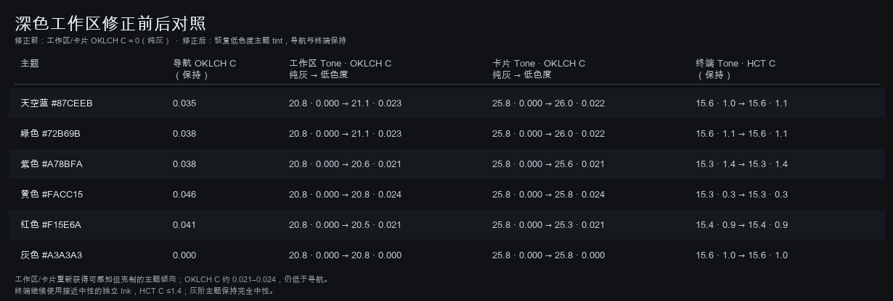
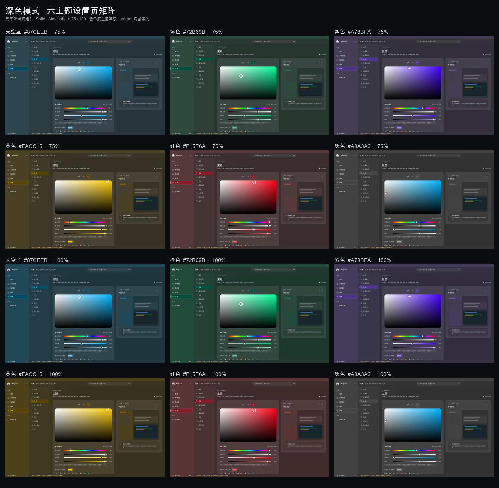
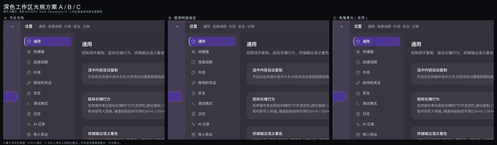
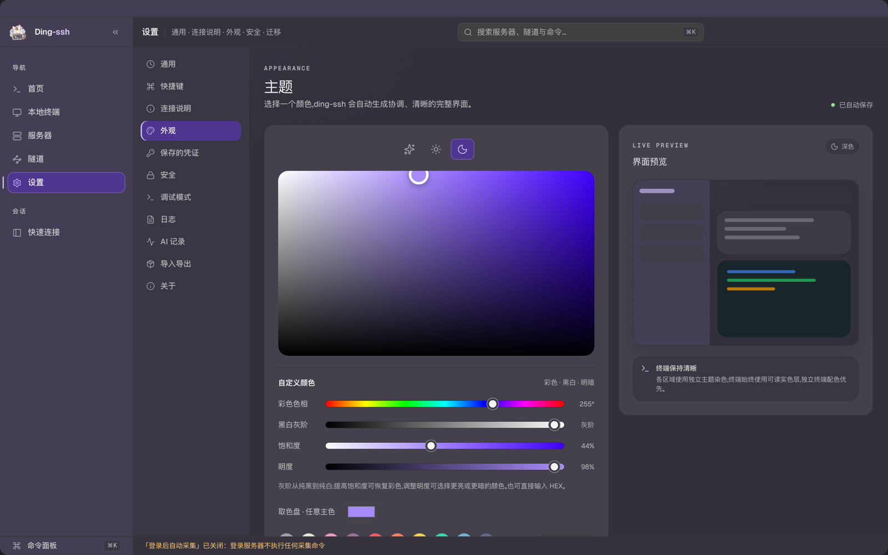
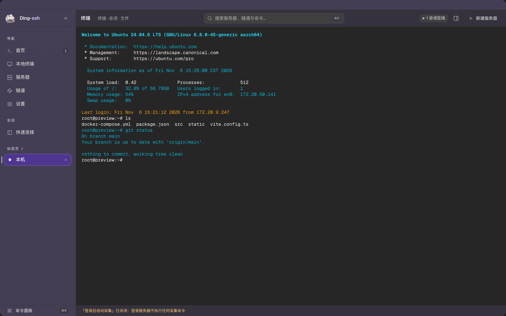
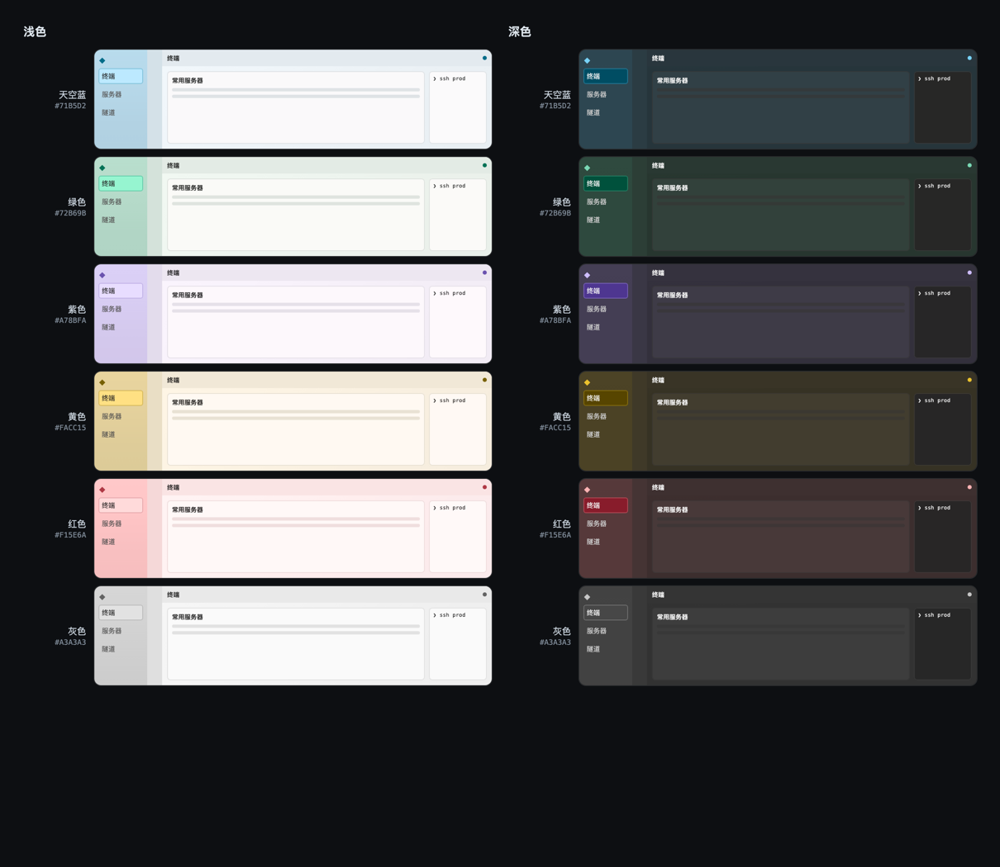

# Ding-ssh 动态配色系统

> 实现状态：阶段 1–4 已完成；Solid 模式已通过自动化验收。原生毛玻璃的跨平台视觉验收仍需在真机执行（见文末矩阵）。

本文件描述重构后的实现，取代 `docs/主题设计方案.md` 中关于 OKLCH 生成算法的部分。设计目标与交互流程仍然有效。

## 1. 架构

```
Pinia settings (单一状态源)
  └─ UIAppearance: seed / tone / atmosphere / separation / materialMode
        │
        ▼
composables/useTheme.ts
  ├─ normalizeAppearance()          旧配置补全与夹取
  ├─ computeTheme()                 纯函数
  │    ├─ material.ts: deriveColorRoles()   HCT 色板 + 深色中性骨架 + OKLCH tint
  │    ├─ material.ts: darkHueWeight()      深色连续色相权重
  │    ├─ material.ts: A/B/C workspace      深色工作区光照策略（内部固定）
  │    ├─ material.ts: planMaterial()       材质能力与透明度
  │    └─ material.ts: rolesToCssVars()     语义 Token + 兼容别名
  ├─ applyRootTheme()               写入 <html> 自定义属性
  └─ writeThemeCache()              启动首帧缓存（防闪烁）
        │
        ▼
CSS: tokens.css → semantic.css → components.css → style.css
```

约束：

- 所有生成颜色的函数都是纯函数，不读取 DOM、store 或时间。
- 组件不再自行计算颜色，只消费语义 Token。
- 终端 ANSI 色板与应用主题完全解耦，主题切换只更新 xterm options。

## 2. 文件职责

| 文件 | 职责 |
| --- | --- |
| `frontend/src/theme/material.ts` | HCT 色板、深色中性骨架、Tint Influence、OKLCH tint/环境光、对比度保护、材质计划、Token 映射 |
| `frontend/src/theme/engine.ts` | 字体、明暗解析、CSS 应用、启动缓存、终端背景辅助 |
| `frontend/src/theme/migrate.ts` | schema 4 迁移、旧字段兼容、外观归一化 |
| `frontend/src/composables/useTheme.ts` | Pinia → CSS 的唯一响应式桥 |
| `frontend/src/theme/semantic.css` | 语义 Token 静态兜底 + 旧 Token 兼容层 |
| `frontend/src/theme/components.css` | 组件别名，全部指向语义 Token |
| `frontend/index.html` | 首帧读取主题缓存，避免默认主题闪烁 |

## 3. 配色引擎

使用 `@material/material-color-utilities@0.3.0`（0.4.0 的 ESM 内部 import 缺少扩展名，在 Vitest / Node 原生 ESM 下无法解析；0.3.0 提供相同的 HCT / Tonal Spot API）：

- `Hct.fromInt(argbFromHex(seed))` 取得种子的 HCT。
- `SchemeTonalSpot` 生成 Primary / Secondary / Tertiary / Neutral / Neutral Variant / Error 六组色板。
- 默认变体固定为 Tonal Spot；相同输入与配置得到完全相同的输出。
- 大面积背景 **不直接使用** Material 背景角色，也不把 seed 直接铺满界面。

### 3.1 三级色彩表达与深色中性骨架

浅色模式继续使用已验证的三级表达：主导航主题最强，二级导航/工作区保留低色度主题倾向，卡片接近中性。

深色模式采用不同的设计：**先用独立于 Seed Hue 的 Tone 骨架建立层级，再给大面积表面施加低色度主题 tint，最后叠加局部柔光**。主题色不再直接把整个右侧铺成 Seed Hue，但工作区/卡片/工具栏也不是纯灰：它们保留 OKLCH C≈0.021–0.024 的可感知倾向；终端保持接近中性。

浅色（atmosphere=75、separation=65）：

| 区域 | tone | HCT chroma（天空蓝 #87CEEB） |
| --- | --- | --- |
| 主导航 | ≈ 83.7 | ≈ 22.1 |
| 二级导航 | ≈ 88.7 | ≈ 10.6 |
| 顶部工具栏 | ≈ 92.3 | ≈ 7.6 |
| 工作区 | ≈ 95.5 | ≈ 6.9 |
| 卡片 | ≈ 98.0 | ≈ 2.6 |
| 抬升卡片 | ≈ 98.8 | ≈ 2.6 |

深色（atmosphere=75、separation=65，天空蓝 #87CEEB）：

| 区域 | HCT tone | HCT chroma | OKLCH chroma | 说明 |
| --- | --- | --- | --- | --- |
| 终端 Ink | ≈ 15.6 | ≈ 1.0 | ≈ 0.000 | 独立中性 Ink，最稳定 |
| 工作区 Canvas | ≈ 21.1 | ≈ 12.5 | ≈ 0.023 | 低色度主题基底，不再纯灰 |
| 顶部工具栏 | ≈ 21.7 | ≈ 12.5 | ≈ 0.022 | 与工作区仅约 1 tone 差 |
| 二级导航 | ≈ 24.2 | ≈ 13.7 | ≈ 0.025 | 中低主题 tint |
| 卡片 | ≈ 26.0 | ≈ 12.4 | ≈ 0.022 | 比工作区高约 5 tone |
| 主导航 | ≈ 28.2 | ≈ 17.9 | ≈ 0.035 | 主题表达主区域 |
| 抬升卡片 | ≈ 28.4 | ≈ 12.4 | ≈ 0.022 | 内容抬升层 |
| 左上角柔光 | — | — | ≈ 0.028（75%）/ 0.041（100%） | 局部主题光，不是表面 |

> HCT 对中性 hex 会报告约 1.1–1.3 的残差 chroma；当前工作区/卡片的 HCT C≈12 是可见的低色度 tint，OKLCH C≈0.022 用于判断感知强度。HCT 与 OKLCH 单位不同，不能直接比较数值大小。

> 工程实现：`DARK_TINT` 的区域预算为主导航 1.0、二级导航 0.72、工具栏 0.60、工作区 0.62、卡片 0.60；这些影响值用于生成最终颜色，不是 CSS opacity。终端使用独立 `DARK_TERMINAL_INK`（HCT C≤1.5），不参与大面积 tint。

深色 Tone 层级刻意拉宽，避免所有表面挤在中暗灰：

```
终端 15.6 < 工作区 21.1 < 工具栏 21.7 < 二级导航 24.2 < 卡片 26.0 < 主导航 28.2 < 抬升卡片 28.4
```

- 工作区比旧版更亮（≈18 → ≈21），并恢复低色度主题倾向；灰暗感由明度层级、卡片抬升、终端下沉和局部柔光共同解决。
- 卡片比工作区高约 5 tone；卡片不是纯灰，但 OKLCH C≈0.022，仍处于低色度内容表面范围。
- 顶部工具栏只比工作区高约 1 tone，通过 1px 边框分区，不再形成暗色横条。
- 终端比工作区更暗、更中性，形成稳定的 Ink 层；它不跟随工作区 Atmosphere 提高饱和度。
- 主导航与工作区 Tone 差约 7，工作区是低色度基底，不会出现“整片鲜艳 + 灰雾”并存。
- 红色主题的工作区为低色度暖灰，紫色为低色度紫灰；它们保留主题身份，但不会回到高饱和大面积。

### 3.2 Theme Atmosphere

`atmosphere` 在深浅模式下的作用被明确分开：

- 浅色：控制大面积表面的色度，并在高强度时轻微降低表面 tone，让 HCT 在 sRGB 内渲染出蓝白/绿白等有色纸面。
- 深色：在低色度安全范围内提高工作区/卡片/工具栏的主题 tint，同时提高主导航、二级导航和左上角柔光的预算；不会把大面积推到高饱和。
- 0：深色工作区为中性墨色，导航仍保留最低限度的主题身份。
- 75：默认；导航清晰、二级导航中低 tint、工作区/卡片低色度 tint（OKLCH C≈0.022）、左上角有极弱主题光。
- 100：主导航/二级导航/局部柔光达到安全上限，工作区/卡片 tint 约 OKLCH C≈0.03；仍属于深色低色度范围，不会出现大面积鲜艳背景。

它不会改变 accent 的色度，因此“氛围强度”与“交互可辨识性”互不牺牲。

### 3.3 深色色相感知控制

深色主题 tint 使用连续 hue 权重 `darkHueWeight(hue)`：

- 中心在冷色（蓝/青，约 210°），余弦函数平滑过渡到暖色（红/黄/紫）。
- 冷色允许略高的 tint chroma；暖色在深色低明度区更容易显脏，因此平滑降低允许量。
- 没有 hue 分段、没有为某个颜色写死分支；灰/近灰种子直接跳过 tint，保持中性。
- 该权重作用于深色 tint budget（导航、二级导航、工作区/卡片/工具栏、局部柔光），不改变浅色已验证的映射。

HCT 与 OKLCH 的职责不同：

- HCT tone 负责深色中性骨架的明度层级。
- HCT chroma 用于主导航/二级导航/工作区/卡片/终端的预算与可读性检查。
- OKLCH chroma 用于把 tint 施加到中性基色上（保持 L 来自骨架，只改变 C 与 H），这样不会因主题色改变而破坏明度结构。

### 3.4 Surface Separation

只控制区域之间的 tone 距离，不改变整体透明度，也不通过 `opacity` 模拟。深色模式先拉开中性骨架的 tone（终端/工作区/卡片/浮层），再让主题 tint 跟随；浅色模式保持原有映射。

### 3.5 对比度保护

`ensureTone()` 在 HCT tone 轴上单向搜索最近的可读 tone：

- 正文 ≥ 7:1，次级文字 / 弱化文字 ≥ 4.5:1（对所有实际使用的背景检查）。
- accent、focus ring、strong border ≥ 3:1。
- 状态色在普通表面与 12% 染色徽章上均 ≥ 4.5:1。
- accent 上的文字自动选择白或近黑，目标 ≥ 4.5:1。
- 若无法达到目标，回退到纯黑/纯白，绝不输出不可读组合。

状态色使用固定语义色相（success≈145、warning≈78、error≈25、info≈250），不随种子变化。选择红色/绿色主题时，状态仍通过固定色相、色调与“图标 + 弱背景”保持辨识度。

### 3.6 Ambient Gradient 环境渐变

深色工作区比较了三种方案（真实设置页截图见第 11 节）：

| 方案 | 做法 | 结论 |
| --- | --- | --- |
| A · 完全实色 | 只用低色度 `--workspace-bg` | 最干净、最稳定，但缺少局部氛围 |
| B · 极弱明度渐变 | 135° 透明明度 overlay，色度恒定 | 与 A 接近，仍有整面 wash 的倾向 |
| C · 角落柔光 | 左上角 65%×45% 椭圆，主题 tint + 低 Alpha | 只在局部形成光感，不产生全幅灰雾；采用 |

最终规则：

- 主导航：保留弱纵向渐变（深色为低 Alpha overlay + 基础色底层）。
- 普通工作区：默认 C，左上角局部柔光；基础色是低色度 `--workspace-bg`。
- 二级导航、工具栏、卡片、表单、输入框、弹窗、SSH 终端：保持实色，不接渐变。
- 浅色工作区继续使用原有 135° 弱明度渐变；深色不再使用全幅 135° 渐变。
- 深色 overlay 不引入 hue 漂移；chroma 恒定，只调整极小的 OKLCH L。
- 局部柔光峰值参与文字对比度检查（composite 后仍需 ≥ 4.5:1）。
- 基础色与渐变定义分离；组件始终保留 `var(--gradient, var(--base-bg))` 回退。
- Solid 模式下基础层完全不透明；Soft / Clear 下基础层使用对应区域 Alpha，overlay 只在局部增加光感，不做全窗口主题遮罩。
- 渐变方向固定（导航 180°，工作区柔光固定在左上），不同页面不会产生随机方向。
- 不添加用户滑块；A/B/C 选择是内部固定策略。

Token 与回退：

```css
/* 运行时由引擎注入；缺失时组件回退到基础语义色 */
--sidebar-primary-gradient
--sidebar-primary-gradient-start
--sidebar-primary-gradient-end
--workspace-gradient
--workspace-gradient-start
--workspace-gradient-end
```

```css
background: var(--workspace-gradient, var(--workspace-bg));
```

引擎输出的是完整 background 值：深色为 `radial-gradient(...), <base color>`，基础色作为最后一层，因此 Solid 不会透出、Glass 不会被叠加两次主题遮罩。没有渐变能力或未来关闭渐变时，只需不写渐变 Token，组件自动回退到基础色。禁止在组件内直接写 `linear-gradient(...)` 来表达主题。

## 4. 语义 Token

新增 Token（完整列表见 `material.ts` 的 `rolesToCssVars`）：

```css
/* 表面 */
--app-bg --sidebar-primary-bg --sidebar-secondary-bg --workspace-bg
--surface-bg --surface-raised-bg --surface-overlay-bg --toolbar-bg

/* 交互 */
--interactive-hover-bg --interactive-active-bg --interactive-pressed-bg
--interactive-disabled-bg --focus-ring-color

/* 文字 */
--text-primary --text-secondary --text-muted --text-disabled --text-on-accent

/* 边界 */
--border-subtle --border-default --border-strong

/* 强调 */
--accent-bg --accent-hover-bg --accent-foreground
--accent-weak-bg --accent-border --accent-strong-border

/* 状态 */
--status-success --status-warning --status-error --status-info
--status-*-bg --status-*-border

/* 环境渐变（运行时注入，缺失时回退基础表面色） */
--sidebar-primary-gradient --sidebar-primary-gradient-start --sidebar-primary-gradient-end
--workspace-gradient --workspace-gradient-start --workspace-gradient-end

/* 终端与材质 */
--terminal-bg --glass-shell-blur --glass-overlay-blur
--glass-opacity --glass-tint
```

兼容层继续提供 `--background`、`--surface-1..4`、`--foreground`、`--primary*`、`--success`、`--destructive`、`--theme-bg-*` 等旧名称。旧组件不需要一次性重写；迁移完成后可逐项删除兼容层。

## 5. 材质系统

五层职责：

1. **Native Backdrop**：macOS `NSVisualEffectView`（Sidebar / BehindWindow / Active）与 Windows Acrylic，保持原实现不变。
2. **Theme Tint**：每个区域使用自己的带 Alpha 背景 Token。
3. **Surface Opacity**：`materialMode` + 不透明度滑块计算各区域 alpha。
4. **Readability Protection**：终端、输入框、密码区域、弹窗使用高不透明度；终端永远不透明。
5. **Capability Fallback**：没有原生 backdrop 时自动回退 Solid。

### 模式

| 模式 | 主导航 alpha | 工作区 alpha | 卡片 alpha | 浮层 alpha |
| --- | --- | --- | --- | --- |
| Solid | 1 | 1 | 1 | 1 |
| Soft Glass | ≈ 0.86 | ≈ 0.88 | ≈ 0.94 | ≈ 0.97 |
| Clear Glass | ≈ 0.72 | ≈ 0.74 | ≈ 0.88 | ≈ 0.93 |

- 前端不再给外壳区域添加 `backdrop-filter`，避免与系统毛玻璃重复模糊。
- 只有浮层（菜单、弹窗、快速连接面板）使用 `--glass-overlay-blur` 模糊其后的应用内容。
- `--glass-shell-blur` 始终为 `0px`，保留该变量仅用于未来平台验证。
- 主导航、二级导航、工作区、卡片分别使用自己的 Token，禁止全窗口共享同一个半透明背景。
- 深色工作区的基础色是低色度主题表面；左上角局部柔光使用低 Alpha overlay，基础色始终作为最后一层参与材质合成。
- 主导航与工作区的 Alpha 仍按区域分别计算；卡片、表单、输入框、弹窗、终端不叠加渐变，保持更高的不透明度或不透明实色。
- 不使用容器级 `opacity`；透明度只存在于背景色 alpha 中，文字保持 100% 不透明。
- Solid 模式下所有基础表面（外壳、导航、工作区、卡片、浮层、输入框、终端）输出为不透明 hex；交互悬停可以叠加透明色，但它只会与已不透明的区域合成，不会透出桌面。
- 代码中禁止在 `bg-slate-*` / `bg-white/*` 等工具类上使用透明度修饰来绘制表面。

### 平台能力

| 平台 | 原生 backdrop | 前端行为 |
| --- | --- | --- |
| macOS (Wails) | NSVisualEffectView | 允许 Soft / Clear |
| Windows 10/11 (Wails) | Acrylic | 允许 Soft / Clear（旧系统依赖现有透明回退） |
| Linux | 无统一桌面模糊 | 强制 Solid |
| 浏览器 / vite dev | 无 | 强制 Solid |

`detectCapabilities()` 通过 `window.runtime` 与 UA 判断。不支持时界面显示提示，并自动使用 Solid。

## 6. 终端

- 应用主题不再写入终端 ANSI 16 色；`--terminal-bg` 只是应用侧的协调背景。
- 终端背景始终是不透明实色，即使外壳使用 Clear Glass。
- 深色终端使用独立的中性 Ink：tone 稳定在 ≈15.2–15.6，不随工作区 Tone/Atmosphere 抬升；HCT Chroma 建议上限 1.5，实测 ≈0.3–1.4。终端不参与工作区主题 tint 或局部柔光。
- “终端跟随应用主题”默认开启：终端背景跟随应用的浅色/深色与种子色，光标和选区使用应用 accent；ANSI 16 色、终端前景和独立配色方案保持不变。
- 关闭后完整使用终端方案自身的背景、光标与选区，保留用户显式选择的独立终端主题。
- 主题变化只更新 xterm `options.theme`，不销毁实例、不重建连接、不重置滚动位置。
- 终端文字仍通过 `terminalContrastForeground()` 做最终对比度保护；xterm 的 `minimumContrastRatio = 4.5` 为 ANSI 文本兜底。

## 7. 迁移

`schema 4`：

| 旧字段 | 新字段 | 规则 |
| --- | --- | --- |
| `colorIntensity` | `atmosphere` | 原值迁移并夹取到 0–100 |
| 无 | `surfaceSeparation` | 默认 65 |
| `glassEnabled` | `materialMode` | true → `soft`，false → `solid` |
| 无 | `colorIntensity` | 继续镜像 `atmosphere`，供旧代码读取 |

- 迁移不会丢弃 `primary` / `secondary` / `baseTone` / `presetId` / 终端主题 / 字体。
- schema < 3 的历史默认值迁移逻辑保持不变。
- 备份写入 `ding-ssh:theme-v4-migration-backup`（同时保留旧 key）。
- `normalizeAppearance()` 在每次加载与保存时幂等归一化，防止脏值。

## 8. 启动防闪烁

1. `index.html` 在 Vue 启动前读取 `ding-ssh:dynamic-theme-v1` 缓存并写入 `<html>`。
2. `useTheme` 在 `settings.loaded === false` 时 **不写主题**，避免默认主题覆盖缓存。
3. 设置加载完成后重新计算并覆盖；由于引擎是确定性的，颜色不会跳变。
4. 首次安装无缓存时使用 `semantic.css` 的静态深色兜底；升级后的第一次启动可能短暂显示兜底主题，第二次启动起即无闪烁。

## 9. 开发约定

- 新组件只使用语义 Token，不引用 `--gray-*`、`--blue-*` 等基础色阶。
- 新增大面积区域时，必须在 `toneLayout` 中定义 tone，并加入文字对比度检查列表。深色大面积默认使用中性骨架；主题 tint 只能通过 `DARK_TINT` 预算或局部柔光引入。
- 深色工作区/卡片/工具栏只允许通过 `DARK_TINT` 的低色度 tint 继承主题；不得直接用高饱和 Seed Hue 铺大面积。终端保持接近中性，主题身份主要放在导航、选中项、按钮、焦点和局部柔光。
- 新增交互状态时使用 `--interactive-*` 或 `--accent-*`，不要用 accent 文字单独表示选中。
- 修改材质参数只允许影响 alpha、blur、tint；不得生成第二套配色。
- 修改配色算法后必须运行：

```bash
cd frontend
npx vue-tsc --noEmit
npx vitest run
npm run build
```

## 10. 验证记录

- `npx vue-tsc --noEmit`：通过。
- `npx vitest run`：28 个测试文件、129 项测试通过（含深色中性骨架、HCT/OKLCH 色度分层、A/B/C 工作区策略、终端独立低色度、渐变端点文字对比度、Solid 不透明表面、终端同步与系统明暗联动）。
- `npm run build`：通过。
- `GOCACHE=/tmp/go-build-dsh go build ./internal/...`：通过。
- `wails build -m -skipbindings -nopackage`（darwin/arm64）：通过。
- 任意色相抽样（18 个色相 × 3 个 Atmosphere × 3 个 Separation × 2 个明暗 = 324 组）：深色工作区/卡片 OKLCH chroma ≈0.021–0.034（Atmosphere>0 且默认/高 Separation），终端 HCT chroma ≤1.38，渐变区文字最低对比度 4.50:1。

## 11. 验收矩阵

### 11.1 修正前后 Tone / Chroma（纯灰 → 低色度）



表中列出修正前（纯灰）与修正后的 Tone / OKLCH Chroma。修正前工作区/卡片 OKLCH C=0，右侧死灰；修正后恢复低色度主题 tint（约 0.021–0.024），仍低于导航。终端保持接近中性。HCT 与 OKLCH 单位不同，不直接比较数值大小。

### 11.2 六主题深色设置页矩阵



上图为实际 Vue 组件与 CSS 渲染的设置页（通过静态预览桥接 Wails 后端数据，不是简化色块）：六主题 × Atmosphere 75 / 100，Solid，默认 corner 局部柔光。工作区/卡片/工具栏使用低色度主题基底，主题身份由主导航、选中项、二级导航、低色度基底和左上角柔光共同承担。

### 11.3 工作区光照方案 A/B/C



A 完全实色最干净但无氛围；B 与 A 接近，仍有整面 wash 倾向；C 只在左上角引入低 Alpha 主题光，未形成全幅灰雾，因此作为默认。

### 11.4 真实设置页与终端页





设置页展示低色度主题基底、卡片明度层级与局部主题光；终端页展示独立低色度 Ink。两张图均由实际组件树渲染，终端内容为预览桥接注入的示例输出，不代表真实 SSH 会话内容。

### 11.5 浅色 / 深色总览



上图为同一批语义 Token 的界面切片：浅色保留原有 135° 工作区渐变；深色工作区/卡片/工具栏使用低色度主题基底，左上角有局部主题柔光，终端保持接近中性。

自动化覆盖（`material.test.ts` / `engine.test.ts` / `migrate.test.ts`）：

| 输入 | 浅色 Solid | 深色 Solid | 浅色 Soft | 深色 Soft | Clear |
| --- | --- | --- | --- | --- | --- |
| `#87CEEB` | ✅ | ✅ | ✅ 逻辑 | ✅ 逻辑 | ✅ 逻辑 |
| `#72B69B` | ✅ | ✅ | ✅ 逻辑 | ✅ 逻辑 | ✅ 逻辑 |
| `#A78BFA` | ✅ | ✅ | ✅ 逻辑 | ✅ 逻辑 | ✅ 逻辑 |
| `#FACC15` | ✅ | ✅ | ✅ 逻辑 | ✅ 逻辑 | ✅ 逻辑 |
| `#EF4444` | ✅ | ✅ | ✅ 逻辑 | ✅ 逻辑 | ✅ 逻辑 |
| `#F15E6A` | ✅ | ✅ | ✅ 逻辑 | ✅ 逻辑 | ✅ 逻辑 |
| `#A3A3A3` | ✅ | ✅ | ✅ 逻辑 | ✅ 逻辑 | ✅ 逻辑 |
| `#F8FAFC` | ✅ | ✅ | ✅ 逻辑 | ✅ 逻辑 | ✅ 逻辑 |
| `#111827` | ✅ | ✅ | ✅ 逻辑 | ✅ 逻辑 | ✅ 逻辑 |

“逻辑”表示已验证 Token、alpha、对比度与降级路径，未进行真机视觉验收。

## 12. 未验证项与后续测试清单

| 项目 | 状态 | 说明 |
| --- | --- | --- |
| macOS NSVisualEffectView 实机视觉 | 未验证 | 需在 macOS 真机确认 Sidebar 材质与区域 tint 叠加效果 |
| Windows Acrylic 实机视觉 | 未验证 | 需在 Win10/11 确认 Acrylic 亮度与 alpha 叠加 |
| Windows 旧系统透明回退 | 未验证 | 需确认无 Acrylic 时 Solid 降级是否触发 |
| Linux 桌面合成器 | 未验证 | 当前强制 Solid，未开启窗口透明 |
| 复杂壁纸下的文字对比度 | 未验证 | 已有保守 alpha 与终端实色保护，仍需真机检查 |
| 高 DPI / 缩放下的材质边缘 | 未验证 | 不涉及布局改动，建议回归 |
| 100% 饱和度极端 seed 的长时间舒适度 | 部分验证 | 已有色度上限与 tone 约束，建议人工目检 |
| 主题切换时的终端滚动位置 | 逻辑保证 | 未销毁实例，建议真机长会话回归 |
| 设置页 / 终端页面截图基线 | 部分验证 | 已用实际 Vue 组件 + CSS 生成深色截图（预览桥接 Wails 数据）；原生窗口/毛玻璃仍需在 macOS + Windows 真机留基线 |

## 13. 已知取舍

- 深色工作区/卡片/工具栏保留低色度主题基底，但不做高饱和大面积染色；终端保持接近中性。偏好“整片工作区都明显染色”的用户会觉得右侧更收敛，偏好纯中性的用户则会觉得仍有主题色。

- 状态色使用固定语义色相，红色主题下 error 与 accent 可能相近；通过固定色调、弱背景与图标/文字标签区分。
- 终端跟随应用主题时，应用会把终端背景切换到当前 UI 的明暗；终端方案的 ANSI 色仍按原样保留，xterm 的 `minimumContrastRatio` 负责可读性兜底。需要完整保留终端方案背景/光标/选区时关闭“终端跟随应用主题”。
- 原生毛玻璃的真实桌面背景未知，无法承诺任意壁纸下都满足对比度；因此终端与重要浮层使用高不透明度保护。
- 为保持现有布局与交互，少量旧 Token 仍作为兼容别名存在；它们全部指向新语义角色，不会产生第二套主题状态。
