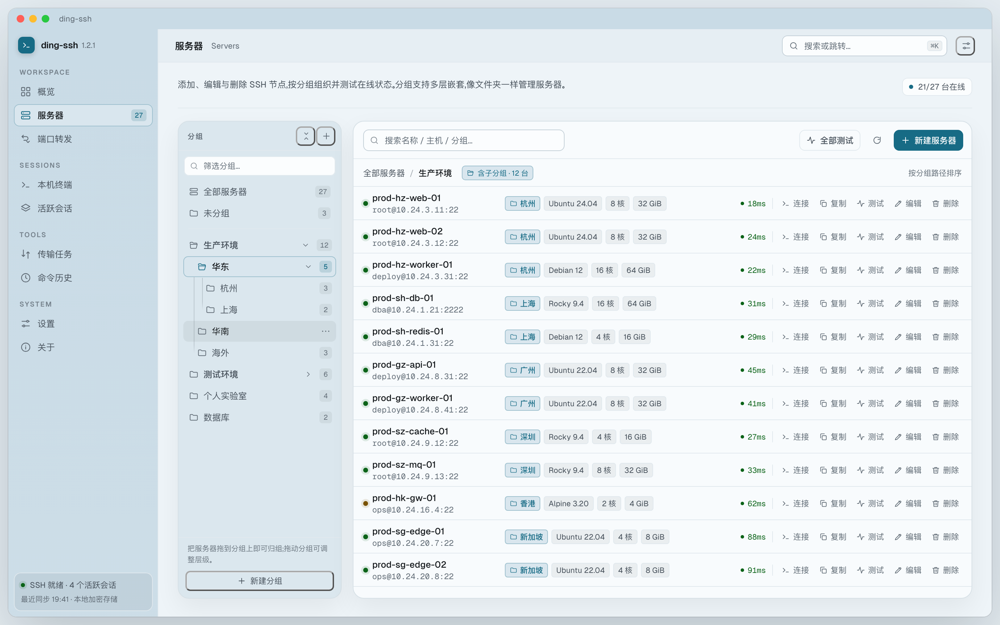
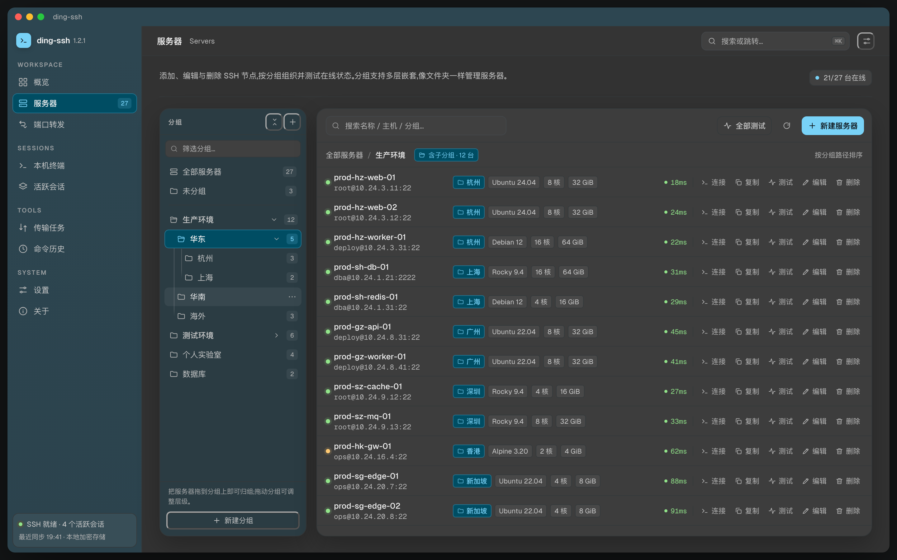

# 服务器分组嵌套（文件夹结构）设计方案

> 状态：已实现（2026-11-20）。分组之间拖拽调整层级（`MoveGroup`）列为后续 TODO。
>
> 目标：让分组支持多层嵌套（默认上限 6 级）、像文件夹一样展开/收起/拖拽/搜索，同时保持现有数据、导入导出和快速连接面板兼容。
>
> 范围：服务器分组的数据模型、后端存储与接口、服务器页左栏、服务器编辑弹窗、快速连接面板、i18n 与测试。

---

## 0. 结论摘要

| 决策 | 建议 |
| --- | --- |
| 分组身份 | **用完整路径作为分组标识**，例如 `生产环境/华东/杭州` |
| 存储 | `servers.grp` 继续存分组路径；`groups.name` 继续存分组路径。**不新增表、不新增列** |
| 层级分隔符 | `/`（新建时禁止段内出现 `/`） |
| 旧数据 | **无表结构迁移**即可显示为树；旧分组名中已含 `/` 的会自动解释为层级 |
| 选择父组 | 默认包含所有子孙分组的服务器 |
| 主交互 | 左栏树形分组 + 面包屑；支持展开/收起、拖服务器入组、右键菜单、搜索自动展开、键盘导航 |
| 删除父组 | 默认“连同子分组一并删除，服务器变为未分组”，并提供“保留子分组、上移一级” |
| 交付节奏 | 三个阶段：数据结构与树 UI → 编辑与拖拽 → 打磨与扩展 |

先看效果预览（静态设计稿，使用应用现有设计 token 绘制）：

**浅色**



**深色**



> 设计稿源文件：`docs/prototypes/nested-groups.html`，浏览器打开后可直接切换 `?tone=dark` 查看深色。

---

## 1. 现状盘点

### 1.1 现在的数据模型

- 服务器节点上只有一个扁平字段：`ServerNode.Group string`（`internal/models/models.go:26`）。
- 分组本身只在 `groups` 表里保存“手动创建但暂无服务器的空分组”，分组归属完全由服务器的 `grp` 字段决定（`internal/store/group.go:26-28`、`internal/store/sqlite.go:809-812`）。
- 表结构极简：

```sql
-- internal/store/sqlite.go:37-63
servers(..., grp TEXT NOT NULL DEFAULT '', ...)
groups(name TEXT PRIMARY KEY)
```

- `GetGroups()` 把“手动分组”与“服务器正在使用的分组”取并集并排序（`internal/apphost/app.go:927-953`）。
- 重命名分组时，`RenameGroup` 更新 `groups.name`，再逐个保存该分组下的服务器（`internal/apphost/app.go:970-1005`）。
- 删除分组时，`RemoveGroup` 删除分组行，并把该分组下的服务器 `Group` 清空（`internal/apphost/app.go:1007-1037`）。
- `.dingpack` 配置包中分组是 `[]string`，版本 1（`internal/store/dingpack.go:20-29`）。
- SSH Config 导入不解析分组；覆盖导入时会保留已有服务器的分组（`internal/apphost/sshimport.go:120-130`）。

### 1.2 现在的 UI

- 左栏是平铺按钮，没有层级（`frontend/src/components/servers/ServerGroupSidebar.vue:32-40`）。
- 选择某个分组时，列表只做**精确匹配**（`frontend/src/composables/useServerManagement.ts:75-91`）。
- 分组管理弹窗是平铺列表，只展示 `groups.list`（`frontend/src/components/ServerList.vue:87-121`）。
- 服务器编辑弹窗用“选择已有 / 新建分组”两个模式切换（`frontend/src/components/ServerDialog.vue:396-435`）。
  - 这里还有一个现存小问题：可选项只从服务器节点推导，没有读取 `groups.list`，所以“手动创建的空分组”实际上不会出现在下拉里（`frontend/src/components/ServerDialog.vue:45-49`）。
- 快速连接面板按分组平铺聚合，分组可折叠（`frontend/src/components/QuickConnectPanel.vue:63-90, 153-178`）。
- 拖拽只支持“服务器 → 分组”，不支持分组之间移动（`frontend/src/composables/useServerManagement.ts:184-261`）。
- `'all'` 被当作“全部服务器”的哨兵字符串；如果用户真的建一个名为 `all` 的分组，会无法选中（`useServerManagement.ts:46`、`ServerDialog.test.ts:60-70` 已在避免这个哨兵进入选项）。

### 1.3 现有实现的优点与限制

优点：

- 分组就是字符串，SSH 导入、配置包导出、Wails 接口都非常轻。
- 空分组可以被保留，不会因为暂无服务器而消失。
- 已有重命名、删除、拖服务器入组的基础。

限制：

- 无层级，分组多了只能靠命名前缀（如 `生产-华东`）人工分类。
- 重命名父级时需要逐个更新服务器；目前不是事务，失败会留下半更新状态。
- 分组名就是身份，排序只能字符串排序。
- 树形 UI 需要“父路径不存在”的容错（例如只有 `生产/华东/杭州`，没有显式建过 `生产` 和 `生产/华东`）。

---

## 2. 目标与非目标

### 2.1 目标

1. 分组支持多层嵌套（默认上限 6 级），像文件夹一样展开、收起、新建子分组。
2. 左栏一眼看清层级；深层分组不破坏布局，不出现横向滚动。
3. 选择父分组时，默认显示该分组及全部子孙分组的服务器。
4. 拖拽服务器到任意层级；分组本身也可以在后续阶段拖拽调整层级。
5. 搜索分组或服务器时，自动展开命中的路径并高亮。
6. 编辑服务器时可以从树里选分组，也可以顺手输入 `父/子` 新建层级。
7. 旧数据无感升级，`.dingpack` 与现有接口尽量不变。
8. 明暗主题、125%/150% 界面缩放、窄窗口下都保持美观。

### 2.2 非目标（本期不做）

- 分组跨设备同步、共享、权限控制。
- 分组收藏、分组图标/颜色、分组备注。
- 手动拖拽排序（第一阶段先按名称排序，后续再加 `sort_order`）。
- 在分组上启动批量命令/批量终端。
- 把分组做成真正的文件系统目录（不涉及磁盘路径）。

---

## 3. 数据模型

### 3.1 三个候选方案

| 维度 | A. 路径即身份（推荐） | B. 独立分组表 + parent_id | C. 闭包表 / ltree |
| --- | --- | --- | --- |
| 数据表示 | `ServerNode.Group = "生产/华东"` | `servers.group_id` + `groups(id,parent_id,name)` | 额外关系表 |
| 旧数据迁移 | 几乎为零 | 需要新列/新表 + 全量映射 | 复杂迁移 |
| 新建层级 | 直接写路径 | 逐级创建并拿 ID | 复杂 |
| 重命名父组 | 级联更新路径（一条 SQL） | 只改一行 | 复杂 |
| 移动服务器 | 改字符串 | 改 group_id | 改关系 |
| `.dingpack` v1 | 直接兼容 | 需要 v2 映射 | 需要 v2 |
| SSH 导入 | 直接兼容 | 需要映射 | 需要映射 |
| 同名不同父 | 支持（全路径唯一） | 支持 | 支持 |
| 手动排序/图标/备注 | 需要旁路字段 | 天然支持 | 天然支持 |
| 前端复杂度 | 中等（需要建树） | 中等偏高（ID/路径互转） | 高 |
| 风险点 | 父组重命名要级联、名字不能含 `/` | 迁移与兼容成本高 | 过度设计 |

**推荐 A：路径即身份。** 理由：

- 现有代码里“分组名”本身就是服务器上的字符串；改成路径后，**服务器数据结构、配置包、SSH 导入、Wails 绑定都不需要换字段**。
- 父组重命名、移动子树都可以用一条前缀 SQL 完成，且能在 SQLite 事务里保证原子性。
- 旧数据不需要迁移表结构；甚至旧版本打开新数据也只是把 `生产/华东` 当成一个扁平名字显示，不会丢数据，降级安全。
- B 方案更“数据库正确”，但要为一次分组功能引入 ID、迁移、导入导出 v2、孤儿数据处理，收益（重命名更便宜、可排序）可以用 A 的后续字段补上。

如果未来要做“分组排序 + 分组图标 + 分组备注 + 大量重命名”，可以在 A 上追加 `groups.sort_order`、`groups.icon`，或者再演进到 B；路径仍然可以作为展示层的稳定字段。

### 3.2 路径规则

| 规则 | 约定 |
| --- | --- |
| 分隔符 | `/`，例如 `生产环境/华东/杭州` |
| 未分组 | 空字符串 `''` |
| 父路径 | 去掉最后一个 `/` 及其之后的部分；根分组父路径为 `''` |
| 层级上限 | 新建最多 **6 级**（后端最多接受 8 级，兼容旧数据） |
| 单段长度 | 1–32 个字符（只限制新建；旧数据超长可读） |
| 总长度 | 建议 ≤ 255 字符 |
| 禁止 | 空段（`a//b`）、首尾 `/`、`.`、`..`、段首尾空格、控制字符 |
| 唯一性 | 完整路径唯一；同一父级下自然不能同名 |
| 大小写 | 区分大小写（与现有行为一致） |
| Unicode | 写入前做 NFC 规范化，避免视觉相同、编码不同的两个分组 |
| 保留名 | 不保留；`'all'` 等哨兵改用结构化选择，不再占用分组名 |

> 分隔符选择 `/` 的代价：分组名不能再包含 `/`。考虑过 `\`、`›`、`::`，它们要么与转义/路径冲突，要么对中文输入不友好。`/` 最符合“文件夹”心智，也方便用户输入 `生产/华东`。

**旧数据里已经含 `/` 的分组名**：升级后自动解释为嵌套层级。比如旧分组 `Prod/US` 会变成 `Prod` 下的 `US`。这通常正是用户想要的；需要在更新日志里写明。降级回旧版本时，它又会显示成扁平名字 `Prod/US`，不丢数据。

### 3.3 存储设计

继续使用现有表，不新增结构：

```sql
-- groups.name 现在存“完整路径”
groups(name TEXT PRIMARY KEY)

-- servers.grp 仍然存“完整路径”
servers(..., grp TEXT NOT NULL DEFAULT '', ...)
```

几个关键点：

1. **隐式祖先**：只要服务器属于 `生产/华东/杭州`，`生产` 和 `生产/华东` 就必须出现在分组列表里，即使从来没手动创建过。由 `GetGroups()` 在读取时补齐祖先路径。
2. **空分组**：用户手动创建的空分组仍然落 `groups` 表；新建 `a/b/c` 时把 `a`、`a/b`、`a/b/c` 都写入（`INSERT OR IGNORE`），这样父组即使没有服务器也存在。
3. **不存 parent 列**：父路径可由路径计算，避免两份状态不一致。
4. **不存排序**：第一阶段按路径排序；需要手动排序时再加 `sort_order INTEGER NOT NULL DEFAULT 0`，不影响现有数据。

示例：

```json
{
  "id": "n_01",
  "name": "prod-hz-web-01",
  "group": "生产环境/华东/杭州"
}
```

对应树：

```text
生产环境
├── 华东
│   ├── 杭州   ← prod-hz-web-01
│   └── 上海
├── 华南
└── 海外
```

### 3.4 路径工具函数

建议新增 `internal/store/grouppath.go`（或 `internal/models/grouppath.go`），集中放路径规则，避免前后端各写一套：

```go
// NormalizeGroupPath 校验并规范化用户输入；返回规范路径或错误。
func NormalizeGroupPath(raw string) (string, error)

// GroupParent 返回父路径；根分组的父路径为 ""。
func GroupParent(path string) string

// GroupBase 返回最后一段名称。
func GroupBase(path string) string

// GroupAncestors 返回从根到父级的所有祖先路径（不含自身）。
func GroupAncestors(path string) []string

// GroupDepth 返回层级数，根分组为 1，未分组为 0。
func GroupDepth(path string) int

// IsGroupDescendant 判断 path 是否是 ancestor 的子孙（不含本身）。
func IsGroupDescendant(path, ancestor string) bool
```

前端对应 `frontend/src/utils/groupTree.ts`，只做建树、过滤、计数，不重复实现“是否合法”的业务规则；合法性以 Go 端为准，前端只做即时提示。

### 3.5 兼容与迁移

| 场景 | 处理 |
| --- | --- |
| 现有扁平分组 | 原样读取，显示在根层级；无需迁移 |
| 旧分组名含 `/` | 读取时按路径解释，自动出现在对应父级下 |
| 旧分组名含 `//`、首尾 `/`、控制字符 | 启动时做一次幂等规范化（更新 `groups.name` 与 `servers.grp`，事务内完成），并记录日志；正常数据零改动 |
| 隐式祖先 | `GetGroups()` 动态补齐，不强制写库 |
| `.dingpack` v1 | 载荷不变：`groups []string` 存完整路径，`servers[].group` 存完整路径。新旧版本可互相导入 |
| SSH Config 导入 | 不解析分组，保持现状；覆盖导入保留已有分组路径 |
| 快捷连接折叠状态 | 现有 `localStorage['qconn-collapsed']` 的 key 本来就是分组名；扁平分组名等于根路径，天然兼容 |
| 降级 | 旧版本把 `生产/华东` 当扁平名显示，不丢服务器、不丢分组 |

> 规范化只处理“明显不合法”的旧路径，不会把合法的 `Prod/US` 拆掉或改名；含 `/` 的旧名按新语义解释，这是本次升级的预期行为。

---

## 4. 后端设计

### 4.1 接口调整

保留现有 Wails 方法名，尽量不破坏前端调用习惯：

| 方法 | 建议签名 | 说明 |
| --- | --- | --- |
| `GetGroups` | `() []string` | 返回**所有**分组路径（含隐式祖先），按路径排序 |
| `AddGroup` | `(path string) error` | 规范化后创建路径及所有祖先；已存在则幂等 |
| `RenameGroup` | `(path, newLeaf string) error` | 只改最后一段；级联更新子分组与服务器，事务内完成 |
| `RemoveGroup` | `(path string, keepChildren bool) error` | 删除分组；两种模式见下 |
| `MoveGroup`（第二阶段） | `(path, newParent string) error` | 调整父级；校验不能移入自己的子孙 |
| `GetGroupTree`（可选） | `() []models.GroupNode` | 给 MCP / 命令面板 / 快速连接复用，返回路径、父级、深度、计数 |

> 改签名后需要重新生成 `frontend/wailsjs/go/main/App.{js,d.ts}` 与 `models.ts`，并同步 `frontend/src/services/groups.ts`。如果不想立刻改旧绑定，可以保留 `RemoveGroup(name)` 作为“递归删除”的兼容包装，另加 `RemoveGroupWithMode(path, keepChildren)`；前端新代码只用后者。

`RenameGroup` 的语义变化需要写清楚：

- 旧：`newName` 是完整分组名。
- 新：`newName` 是**最后一段名称**，不能包含 `/`；前端重命名输入框只编辑叶子名称，父路径以静态文本展示（`生产环境 / [华东]`）。
- 如果旧调用传了带 `/` 的值，直接返回错误“分组名称不能包含 /”，避免歧义。

`RemoveGroup` 的两种模式：

1. **递归删除（默认）**：删除该分组及所有子孙分组；子树内的服务器全部变为未分组（`grp = ''`）。
2. **保留子分组（`keepChildren = true`）**：删除该分组；直接属于它的服务器移动到父分组（根分组则变为未分组）；子分组整体上移一级。

> 如果上移后与父级下已有分组重名，返回错误“目标层级已存在同名分组，请先重命名”，让用户选择递归删除或先处理冲突。不做静默合并。

### 4.2 事务与 SQL

写操作收敛到新的 `internal/store/grouptree.go`（SQLite 事务版），避免现在 `app.go` 里“先删分组、再逐个更新服务器”的半更新状态。JSON 兜底保留现有循环，日志里标注“非事务”。

**重命名（含子孙与服务器）**：

```sql
-- 1) 冲突检查：目标路径或目标子树已存在
SELECT 1 FROM groups
 WHERE name = ?2 OR substr(name, 1, length(?2) + 1) = ?2 || '/'
 UNION ALL
SELECT 1 FROM servers
 WHERE grp = ?2 OR substr(grp, 1, length(?2) + 1) = ?2 || '/'
 LIMIT 1;

-- 2) 同步分组路径
UPDATE groups
   SET name = ?2 || substr(name, length(?1) + 1)
 WHERE name = ?1 OR substr(name, 1, length(?1) + 1) = ?1 || '/';

-- 3) 同步服务器分组
UPDATE servers
   SET grp = ?2 || substr(grp, length(?1) + 1)
 WHERE grp = ?1 OR substr(grp, 1, length(?1) + 1) = ?1 || '/';
```

用 `substr(...)` 而不是 `LIKE`，避免 `%`、`_` 需要转义；`length()` 按字符计，不受中文 UTF-8 字节数影响。

**递归删除**：

```sql
DELETE FROM groups
 WHERE name = ?1 OR substr(name, 1, length(?1) + 1) = ?1 || '/';

UPDATE servers
   SET grp = ''
 WHERE grp = ?1 OR substr(grp, 1, length(?1) + 1) = ?1 || '/';
```

**保留子分组删除**（`?2` 为父路径，根分组时为 `''`）：

```sql
-- 直属服务器上移
UPDATE servers SET grp = ?2 WHERE grp = ?1;

-- 子孙分组与服务器上移一级
UPDATE groups
   SET name = ltrim(?2 || substr(name, length(?1) + 1), '/')
 WHERE substr(name, 1, length(?1) + 1) = ?1 || '/';

UPDATE servers
   SET grp = ltrim(?2 || substr(grp, length(?1) + 1), '/')
 WHERE substr(grp, 1, length(?1) + 1) = ?1 || '/';

DELETE FROM groups WHERE name = ?1;
```

`ltrim(..., '/')` 处理“父路径为空、子分组回到根”的情况，避免生成 `/华南`。

**AddGroup**：循环插入自身与所有祖先，使用 `INSERT ... ON CONFLICT(name) DO NOTHING`；整个过程一个事务。`GetGroups` 仍然要在读取时补齐祖先，防止历史数据或并发写入造成缺口。

**MoveGroup**（第二阶段）：目标路径 = `newParent + "/" + base(path)`；校验：

- `newParent` 合法且存在（或为空 = 根）；
- 目标不等于当前路径；
- 目标不是 `path` 本身或 `path` 的子孙（`IsGroupDescendant`）；
- 目标子树不存在冲突。

复用重命名的前缀 SQL。

### 4.3 计数与排序

- 后端不需要返回计数；前端已经有全量服务器列表，建树时一次算好：
  - `direct`：直接属于该路径的服务器数；
  - `total`：该路径 + 所有子孙的服务器数（父组显示 `total`）。
- 排序：
  - 第一阶段：同级按 `localeCompare`（中文界面按拼音/本地化），与现有 `sort` 行为保持一致。
  - 排序只影响展示，不影响路径身份。
  - 后续如需手动排序，加 `groups.sort_order`；隐式祖先没有行，读取时视为 `0`，第一次手动排序时再落库。

### 4.4 日志与错误

沿用 `logx` 的 DEBUG/INFO/WARN/ERROR 规范：

- 读：`[store] 读取分组树: count=%d elapsed=%s`
- 增/改/删：记录路径、影响的分组数、服务器数、耗时；失败时带 `path`。
- 冲突/非法路径：WARN，返回用户可读的中文错误（走 `internal/i18n/en.json` 翻译）。
- 事务失败：ERROR，包含步骤（冲突检查 / 分组更新 / 服务器更新 / 提交）。

新增错误文案（中文 key，英文补 `internal/i18n/en.json` 与 `frontend/src/locales/en.json`）：

- `分组名称不能为空`
- `分组名称不能包含 /`
- `分组名称不能以 / 开头或结尾`
- `分组路径不能包含空层级`
- `分组层级不能超过 {0} 级`
- `分组名称不能包含控制字符`
- `目标分组已存在`
- `分组不存在`
- `不能把分组移动到自己的子分组中`
- `目标层级已存在同名分组，请先重命名`

### 4.5 JSON 兜底

`app.go` 在 SQLite 打开失败时会退到 JSON 存储（`internal/apphost/app.go:245-266`）。这一路径需要保持功能可用：

- `JSONGroupStore` 的 `List/Add/Rename/Remove` 支持路径字符串与前缀重命名。
- 服务器的级联更新仍由 `app.go` 循环完成；因为 JSON 文件之间无法共享事务，日志记录“非事务更新”，失败时返回错误并提示重试。
- 这一兜底不是主路径，不要求原子性，但不能出现“分组改了、服务器没改”还返回成功的情况。

---

## 5. 前端设计

### 5.1 组件拆分

建议新增/调整：

| 文件 | 作用 |
| --- | --- |
| `frontend/src/utils/groupTree.ts` | 路径工具 + 建树 + 过滤 + 计数（纯函数，易测） |
| `frontend/src/components/servers/GroupTree.vue` | 递归树容器；接收节点、选中、展开集合、拖放状态 |
| `frontend/src/components/servers/GroupTreeRow.vue` | 单行：行首文件夹图标、名称、行尾展开箭头、计数、更多按钮 |
| `frontend/src/components/servers/GroupTreeSelect.vue` | 服务器编辑弹窗里的树形选择器（搜索 + 新建路径） |
| `frontend/src/components/servers/GroupBreadcrumb.vue` | 列表上方的路径面包屑 + 计数 chip |
| `frontend/src/components/servers/GroupContextMenu.vue` | 分组右键菜单（新建子分组、重命名、删除、移动到…） |
| `frontend/src/components/servers/ServerGroupSidebar.vue` | 改为承载 `GroupTree`，保留顶部/底部操作 |
| `frontend/src/composables/useServerManagement.ts` | 选择、筛选、拖拽、增删改、展开状态集中在这里 |
| `frontend/src/stores/groups.ts` | 分组列表 + 本地乐观更新 + 失败回滚 |
| `frontend/src/services/groups.ts` | 同步新的 `RenameGroup` / `RemoveGroup` 绑定签名 |
| `frontend/src/components/ServerDialog.vue` | 用 `GroupTreeSelect` 替换“选择/新建”双模式 |
| `frontend/src/components/QuickConnectPanel.vue` | 复用建树结果，紧凑缩进渲染 |
| `frontend/src/components/ServerList.vue` | 分组管理弹窗树化（或下线，见 5.7） |
| `frontend/src/components/Icon.vue` | 增加 `folder-open`、`folder-plus`、`chevrons-down-up`、`ellipsis` 等 |

### 5.2 选择模型

不要再用 `'all'` / `''` / 分组名混在一个字符串里，建议改成明确的三态：

```ts
type GroupSelection =
  | { kind: 'all' }
  | { kind: 'ungrouped' }
  | { kind: 'group'; path: string }
```

好处：

- 不会和真实分组名 `all` 冲突；
- 面包屑、空态、拖放目标都能明确判断；
- 后续加“仅本组 / 含子分组”开关时不用再猜字符串。

如果为了减小改动，也可以保留字符串，但把哨兵改成独立的 `groupFilter` 字段（`'all' | 'ungrouped' | 'group'`）加 `activePath`，不要再用分组名本身兼任哨兵；长期看仍是对象更清晰。

选中父组时的过滤：

```ts
function inSelectedGroup(serverGroup: string, selection: GroupSelection): boolean {
  if (selection.kind === 'all') return true
  if (selection.kind === 'ungrouped') return serverGroup.trim() === ''
  const path = selection.path
  return serverGroup === path || serverGroup.startsWith(path + '/')
}
```

- 侧栏计数显示 `total`；父组的 tooltip 写“本组 3 台 · 含子分组共 12 台”。
- 列表上方用面包屑明确当前范围：`全部服务器 / 生产环境 / 华东`。
- 面包屑的每一段可点击，点击后切到对应层级。
- 当前分组右侧加 chip：`含子分组 · 12 台`；点击 chip 可切换“仅本组 / 含子分组”（第二阶段，默认含子分组）。

### 5.3 左栏树交互

#### 展开 / 收起

- 只有父组行尾有展开箭头；叶子不占位。所有行的行首文件夹图标与“全部服务器/未分组”对齐。
- 点击行尾的展开箭头切换；点击行本身是“选中”。文件夹图标用展开/收起状态辅助提示层级。
- 默认策略：
  - 首次进入时展开根层级（如果根层级 ≤ 8 个）；
  - 当前选中的路径自动展开所有祖先；
  - 其余层级默认收起，避免一屏铺满。
- 展开状态持久化：`localStorage['ding-ssh:group-expanded'] = ["生产环境","生产环境/华东"]`。
  - 读取时丢弃已经不存在的路径，避免脏 key 无限增长。
  - 搜索时临时展开命中路径，清空搜索后恢复用户原来的展开状态。

#### 新建

- 左栏顶部 `+`：在当前选中分组下新建子分组；没有选中或选中的是“全部/未分组”时，建在根层级。
- 底部“新建分组”按钮保留，默认根层级。
- 内联输入行出现在父组第一行位置（或根层级末尾），前面展示路径前缀，例如：

```text
生产环境 / [ 华东            ]  ⏎ Esc
```

- 输入支持 `a/b` 直接创建多级：在 `生产环境` 下输入 `华东/杭州`，创建 `生产环境/华东/杭州`，并自动展开、选中新分组。
- 提交：`Enter`；取消：`Esc`；失焦默认取消（避免误建）。
- 校验即时提示：空、含非法字符、超深、同级重名；提交失败时在输入框下方显示一行红字，不关闭输入。

#### 重命名

- 右键菜单 → 重命名，或选中行按 `F2`。
- 行内变成输入框，**只编辑最后一段**；前缀保持静态展示。
- 重命名父组时，后端级联更新子路径与服务器；前端重新拉取两组数据，并把当前选中/展开状态跟随新路径。
- 目标同级重名：错误提示“同级已存在同名分组”，留在编辑态。

#### 删除

- 右键菜单 → 删除，弹确认框：

```text
删除「生产环境」？

包含 3 个子分组、12 台服务器。
○ 删除分组及其子分组（服务器变为未分组）   ← 默认
○ 仅删除此分组（子分组上移一级，服务器移到上一级）

[取消]  [删除]
```

- 没有子分组时，不展示第二个选项，只提示“其中 N 台服务器将变为未分组”。
- 删除按钮用危险色；默认焦点在“取消”，避免回车误删。
- 删除后如果当前选中的路径在子树里，自动回到父级（根则回到“全部服务器”）。

#### 拖拽

**服务器 → 分组（第一阶段必须）**

- 复用现有 `text/ding-ssh-server` dataTransfer。
- 拖到行上：整行高亮，背景 `--primary-weak`，1px `--primary-border`；放下后提示“已移动到 生产环境 / 华东”。
- 拖到折叠父组上悬停 500–600ms：自动展开，方便继续往深层拖。
- 拖到“未分组”行：移出分组。
- 拖到树空白处：不处理，避免误操作。
- 拖拽过程中行显示半透明 + 浮动小标签（“移动到 华东”），并给目标行加 `aria-dropeffect`（无障碍）。
- 键盘/无拖拽替代：服务器右键菜单加“移动到分组…”，打开树选择器；这一步建议第一阶段一起做，否则拖拽是唯一入口，对键盘用户不友好。

**分组 → 分组（第二阶段）**

- 拖拽分组行本身，可调整父级；目标行显示 2px 插入线（放到组内）或行间插入线（排序，需 `sort_order`）。
- 兜底：目标是自己或自己的子孙时，整行变红/禁止光标，并提示“不能移动到自己的子分组中”。
- 后端 `MoveGroup` 再做一次校验，不能只靠前端。

#### 右键菜单

| 菜单项 | 说明 |
| --- | --- |
| 新建子分组 | 在该组下内联新建 |
| 在此新建服务器 | 打开服务器弹窗，默认分组为该路径 |
| 重命名 | F2 |
| 移动到… | 第二阶段；打开树选择器，禁止选自己/子孙 |
| 删除 | 带子分组/服务器计数确认 |
| 展开全部 / 折叠全部 | 对整棵树；也可只对当前子树 |

#### 搜索

- 左栏顶部加“筛选分组…”输入框（28px 高）。
- 搜索匹配：分组名称、完整路径、以及“该组下有服务器名称/主机命中”的情况。
- 命中节点保留，祖先自动显示并展开，子孙中不匹配的隐藏；命中文字用 `--accent` 高亮。
- 清空输入后恢复之前的展开状态与滚动位置。
- 服务器列表的搜索仍然走现有 `keyword`，分组路径参与匹配（`s.group.includes(kw)` 已存在，继续保留）。
- 搜索无结果：侧栏显示“没有匹配的分组”一行，不出现大块空态。

#### 键盘与无障碍

- 容器 `role="tree"`，行 `role="treeitem"`，子容器 `role="group"`。
- `aria-level`、`aria-expanded`、`aria-selected`、`aria-label`（含完整路径与计数）。
- Roving tabindex：同屏只有一个 `tabindex="0"`。
- 快捷键：
  - `↑/↓` 上一/下一可见行
  - `→` 展开；已展开则进入第一个子项
  - `←` 收起；已收起则回到父项
  - `Home/End` 首/末
  - `Enter` 选中
  - `F2` 重命名
  - `Delete` 删除（需确认）
  - 连续输入字符做 type-ahead（500ms 内）
- 焦点样式使用现有 `--focus-ring-color`，2px outline + 2px offset。
- 拖放必须有键盘替代路径（右键“移动到…”）。

### 5.4 服务器列表与面包屑

- 列表上方新增面包屑行（40px）：

```text
全部服务器  /  生产环境  /  华东          [含子分组 · 12 台]        按分组路径排序
```

- “全部服务器 / 未分组”显示简单标题，不显示 chip。
- 选中父组时，服务器行里的分组标签显示**相对路径**（例如 `杭州`），`title` 里给完整路径；选中“全部服务器”时显示完整路径或根路径。
- 直属当前分组的服务器，标签显示“直属”或隐藏分组标签（推荐显示一个 muted 的“直属”小标签，避免和子组混淆）。
- 列表行为不变：行内连接/复制/测试/编辑/删除、右键菜单、拖拽排序都不动。

### 5.5 服务器编辑弹窗

把现在的“选择已有 / 新建分组”两个模式换成一个树形选择器：

- 触发器显示当前分组路径（带文件夹图标）或“未分组”。
- 弹出面板 320–360px 宽：
  - 顶部搜索框；
  - “未分组”固定第一行；
  - 下面是分组树，当前值高亮；
  - 底部“＋ 新建分组”，点击后在当前高亮父级下内联输入；
  - 搜索不到时显示“创建分组「xxx」”，支持输入 `父/子` 直接建多级；
  - 面板底部一行灰色提示：“输入 `父组/子组` 可直接创建多级分组”。
- 键盘：`↑/↓` 选择，`→/←` 展开收起，`Enter` 确认，`Esc` 关闭。
- 旧数据中不存在于树里的分组（例如异常路径）作为一条“当前值”显示，避免保存时被静默改掉。
- 新建服务器时的默认分组 = 当前选中的分组路径（选中父组就落在父组，不自动落到第一个子组）；选中“全部/未分组”则为空。

### 5.6 快速连接面板

- 复用 `buildGroupTree`，用紧凑模式渲染：
  - 行高 26–28px，缩进 10–12px；
  - 分组头保留 chevron + 名称 + 数量；
  - 深层级最多缩进 4 级，再深用完整路径 tooltip / 层级 chip；
  - 搜索时自动展开命中路径；
  - 折叠状态继续用 `localStorage['qconn-collapsed']`，key 为路径。
- 面板宽度有限（288px），不要显示完整路径；只在 `title` 和无障碍标签里给完整路径。
- 空分组仍然显示（0 台），方便用户去服务器页整理。

### 5.7 分组管理弹窗

现有弹窗（`ServerList.vue:87-121`）有两个选择：

1. **推荐：保留入口，改成树形管理弹窗。** 复用 `GroupTree` 的管理模式，支持新建子分组、重命名、删除、显示计数；不做拖拽（拖拽在侧栏完成）。优点是用户习惯不丢，窄窗口/侧栏不好操作时仍有完整的管理入口。
2. 直接下线，把能力全部并入侧栏。代码更少，但会让“分组管理”按钮消失，需要确认用户是否接受。

建议第一阶段先做 1 的最小版（树 + 行内重命名/删除 + 新建子分组），视觉上与侧栏一致；如果实现成本高，再退回 2。

### 5.8 状态与数据流

- 分组数据只有一个来源：`groups` store 的 `list` + `servers` store 的 `servers`；树是 `computed`，不要在每个组件里各建一份。
- 写操作流程：
  1. 调用 `groupService`；
  2. 成功后更新本地 `groups.list`（路径前缀替换）与 `servers.servers`（`group` 前缀替换），避免整页闪烁；
  3. 失败：回滚本地状态，toast/行内错误；
  4. 必要时后台 `load()` 校准（例如删除、导入后）。
- 重命名父组时，本地状态同步前缀替换比重新拉取更快，也能避免选中态闪烁；但要在后台再拉一次校准。
- Toast 文案：
  - `已创建分组「生产环境 / 华东」`
  - `已移动到「生产环境 / 华东」`
  - `已重命名，12 台服务器已同步`
  - `已删除分组，3 台服务器变为未分组`

---

## 6. 视觉规范

设计稿使用应用现有的 `tokens.css` / `semantic.css` 语义变量绘制，不引入新的色板；实现时同样只用 token。

### 6.1 尺寸

| 项目 | 值 | 说明 |
| --- | --- | --- |
| 左栏宽度 | 236px（窄窗口 208px） | 现 196px 放不下 3–4 级；236px 在 1440 窗口下与列表比例更平衡 |
| 行高 | 30px | 保持现有紧凑密度 |
| 行间距 | 1px | 发丝分隔，不用分割线 |
| 层级缩进 | 12px/级 | 只保留层级缩进，不再为展开按钮留独立列宽 |
| 树内边距 | 左右 7px | 与卡片圆角对齐 |
| 展开箭头 | 20px 点击区 / 13px 图形 | 位于行尾、计数之前；只有父组有，不占用左侧列宽 |
| 文件夹图标 | 14px | 与“全部服务器/未分组”的行首图标同列对齐；展开父组用 folder-open |
| 名称 | 12.5px | 父组 500，叶子 400，选中 500 |
| 计数 | 10px mono，17px 高 | 继承现有 `.count` 风格 |
| 分组搜索框 | 28px 高 | 侧栏内，圆角 7px |
| 分组头 | 42px 高 | 标题 + 折叠全部 + 新建 |
| 面包屑 | 40px 高 | 路径 + chip |
| 卡片圆角 | 16px | 与现有 `--radius-card` 一致 |

### 6.2 颜色

| 状态 | 颜色 |
| --- | --- |
| 默认文字 | `--foreground-secondary` |
| 父组文字 | `--foreground-secondary`，500 字重 |
| 悬停 | 背景 `--interactive-hover-bg`，文字 `--foreground` |
| 选中 | 背景 `--interactive-active-bg`，1px inset `--accent-border`，文字 `--foreground`；不再额外加左侧竖条 |
| 选中计数 | 背景 `color-mix(in srgb, var(--accent-bg) 16%, transparent)`，文字 `--accent-bg` |
| 层级引导线 | `color-mix(in srgb, var(--muted-foreground) 26%, transparent)`，1px，末行前淡出 |
| 拖放目标 | 背景 `--primary-weak`，1px inset `--primary-border` |
| 拖拽插入线 | 2px `--primary`（第二阶段） |
| 分组 chip（列表行） | 背景 `--accent-weak-bg`，文字 `--accent-bg`，1px `--accent-border` |
| 面包屑 chip | 同上，10.5px |
| 焦点环 | `--focus-ring-color` |
| 禁止目标 | 文字/边框 `--destructive`，背景 `--destructive-weak`（低饱和，不要整行大红） |

**克制原则**：

- 只用一种强调色标记“当前选中”，不要给每一级不同颜色。
- 不要给每个文件夹加大面积背景或阴影；层级靠缩进 + 细引导线表达。
- 深色模式下引导线不要用纯白；用 muted 的 26%，避免“网格感”。

### 6.3 行结构与对齐

```text
[folder 14] 生产环境                              ⌄ 12  ⋯
 ↑           ↑                                   ↑  ↑   ↑
 图标         flex: 1，truncate                   箭头 计数 悬停显示
```

- 计数保持在最右侧固定列宽，避免数字位数变化导致名称抖动。
- 名称 `text-overflow: ellipsis`，完整路径放 `title` / `aria-label`。
- 行尾展开箭头旋转 90°（从 `chevron-right` 到向下），120ms `cubic-bezier(.22,1,.36,1)`。
- 父组与叶子的行首文件夹图标同列；展开箭头只出现在父组行尾，叶子不占位。
- 叶子行尾不显示展开箭头，但行内仍可右键、拖拽。
- 深层（>4 级）：缩进不再增加视觉压力，改为在名称前显示层级数 chip？不建议；继续缩进、名称截断 + tooltip 更直观。若窗口窄到名称不足 80px，允许左栏内部横向滚动（隐藏滚动条，hover 可滚），不压缩到不可读。

### 6.4 动效

- 只做展开箭头旋转、行 hover/active 的背景过渡（100–120ms）。
- **不做高度展开动画**：分组多时容易掉帧，且树形结构高度动画会让相邻行跳动；展开/收起即时完成更稳。
- 新建行可用 800ms 的 `--primary-weak` 淡出高亮，帮助用户定位。
- 遵循 `prefers-reduced-motion`：关闭旋转与高亮动画。

### 6.5 空态与加载

- 侧栏只有“全部服务器/未分组”时，不放大空态；在树区域显示一行灰字“还没有分组”，底部按钮保持可用。
- 分组加载失败：侧栏显示一行错误 + “重试”，不要用整页 ErrorState。
- 服务器列表空态、错误态保持现状，只更新“换个关键词，或切换左侧分组试试”的文案（现在也适用）。

### 6.6 反例（不要这样做）

- ❌ 每一级都用卡片/边框包起来：层级越深越像俄罗斯套娃。
- ❌ 用颜色区分层级：会和状态色、在线状态色冲突。
- ❌ 展开时做 300ms 高度动画：大量分组时卡顿，且拖拽中会错位。
- ❌ 把完整路径直接铺在侧栏：`生产环境/华东/杭州` 在 236px 下不可读；只显示当前段，路径放面包屑/tooltip。
- ❌ 选中父组时只显示直属服务器：用户会以为子组服务器丢了；默认必须含子孙，并用 chip 说明。
- ❌ 删除父组默认“只删自己”：用户以为删掉了整个文件夹，结果子组还在；默认递归 + 明确文案更符合心智。

---

## 7. 关键流程

### 7.1 新建三级分组

1. 左栏选中 `生产环境`；
2. 右键 → 新建子分组（或顶部 `+`）；
3. 输入 `华东/杭州`，即时预览 `生产环境 / 华东 / 杭州`；
4. `Enter` → 后端规范化、插入 `生产环境`、`生产环境/华东`、`生产环境/华东/杭州`；
5. 返回后展开路径、选中新分组，列表显示“暂无服务器”（含子分组 0 台）。

### 7.2 把服务器拖到深层分组

1. 拖起 `prod-hz-web-01`，目标 `生产环境` 行高亮；
2. 悬停 500ms，`生产环境` 自动展开；继续拖到 `华东`，再悬停展开，拖到 `杭州`；
3. 放下 → `servers.save({...node, group:"生产环境/华东/杭州"})`；
4. 目标行 flash，toast `已移动到「生产环境 / 华东 / 杭州」`；
5. 列表如果当前选中父组，自动包含该服务器；如果选中其他组，不强制跳转（可配置：拖拽后是否跳到目标组。建议不跳，避免打断）。

### 7.3 重命名父组

1. 右键 `生产环境` → 重命名；
2. 输入 `Prod`，路径预览 `Prod`；
3. 后端事务：检查组内/服务器冲突 → 更新 `groups` 前缀 → 更新 `servers.grp` 前缀；
4. 前端本地把 `groups.list` 与 `servers.servers` 中 `生产环境` 前缀替换为 `Prod`，选中/展开状态同步；
5. Toast `已重命名，12 台服务器已同步`。

### 7.4 删除父组

1. 右键 `生产环境` → 删除；
2. 对话框显示 `3 个子分组、12 台服务器`；
3. 默认选“删除分组及其子分组（服务器变为未分组）”；
4. 确认 → 事务删除分组子树 + 清空服务器分组；
5. 选中态回到 `全部服务器`，toast `已删除分组，12 台服务器变为未分组`。

### 7.5 搜索

1. 左栏输入 `杭`；
2. 命中 `生产环境/华东/杭州` 及该组下的服务器；
3. 自动展开 `生产环境`、`华东`，其他不匹配分支隐藏；
4. 命中文字高亮；`Esc` 或清空输入恢复原树和滚动位置。

---

## 8. 边界与风险

| 场景 | 处理 |
| --- | --- |
| 旧分组名含 `/` | 按层级解释；更新日志说明；降级显示为扁平名 |
| 旧分组名含 `//`、首尾 `/` | 启动幂等规范化；冲突时合并并 WARN |
| 新建时同级重名 | 拒绝，提示“同级已存在同名分组” |
| 重命名目标已存在 | 拒绝，不合并；避免覆盖 |
| 删除父组时有子组 | 默认递归；提供保留子组选项；保留模式冲突时拒绝 |
| 移动分组到自己子孙 | 前端禁止 + 后端校验双保险 |
| 分组名为 `all` | 用结构化选择后不再是问题；若保留字符串哨兵，必须改用 `@all` |
| 分组深度过大 | 新建限制 6 级；旧数据照常显示 |
| 窗口窄 / 界面缩放 150% | 左栏 208px、缩进 12px、名称截断 + tooltip；不横向溢出 |
| 分组很多（>500） | 树仍可渲染；必要时折叠全部/只渲染可见节点；筛选在 computed 内做 |
| 服务器很多（>2000） | 树计数一次遍历；列表本来就全量渲染，分组改造不增加数量级 |
| 并发写 | SQLite 事务 + `busy_timeout`；失败返回错误并提示重试 |
| JSON 兜底 | 非原子，但必须返回真实失败，不做“假成功” |
| 空分组 | 保留；父组即使没有直属服务器也显示 0/子计数 |
| 分组删除后选中态失效 | 自动回父级或“全部服务器”；不要在空路径上过滤 |
| `.dingpack` 导入旧数据 | 路径直接生效；旧版本显示为扁平名，不丢数据 |
| SSH 导入覆盖 | 保留原分组路径，不做层级推断 |
| 无拖拽设备 / 键盘用户 | 右键“移动到分组…”提供等价路径 |
| 无障碍 | tree 语义、aria、焦点管理、reduced motion |

---

## 9. 实施计划

### 第 1 阶段：数据结构 + 树 UI（核心可用）

**后端**

- [ ] `grouppath.go`：规范化、父路径、祖先、深度、子孙判断。
- [ ] `GetGroups` 补齐隐式祖先，路径排序。
- [ ] `AddGroup` 创建多级路径与祖先。
- [ ] `RenameGroup(path, newLeaf)` 级联事务，冲突校验。
- [ ] `RemoveGroup(path, keepChildren)` 两种模式。
- [ ] 旧路径幂等规范化（启动时）。
- [ ] 单元测试：路径、祖先、重命名、删除、冲突。

**前端**

- [ ] `groupTree.ts`：建树、计数、过滤、`inSubtree`。
- [ ] `GroupTree` / `GroupTreeRow`：展开收起、选中、计数、右键菜单。
- [ ] 左栏替换为树；选择父组含子孙；面包屑。
- [ ] 拖服务器到任意层级；自动展开；toast。
- [ ] 服务器右键“移动到分组…”树选择器。
- [ ] `ServerDialog` 接 `groups.list`，修掉空分组不出现的问题（可先沿用现有选择器，第二阶段再换树选择器）。
- [ ] 快速连接面板树形化（可复用建树结果）。
- [ ] 分组管理弹窗树化（最小版）或暂时保留平铺 + 说明。
- [ ] i18n 中英文补齐。
- [ ] 重新生成 Wails 绑定（`frontend/wailsjs`），确认 `App.d.ts` 签名与 `models.ts` 一致。

**验收**

- 旧数据打开即树形展示，服务器数量、分组数量不变。
- 可以创建 3 级分组、在任意层级拖服务器、选中父组看到子孙服务器。
- 重命名父组后，子组与服务器同步；删除父组有明确确认。
- 现有前端/后端测试全部通过，新增路径与树测试通过。

### 第 2 阶段：体验打磨

- [ ] 分组拖拽调整层级（`MoveGroup`）。
- [ ] 键盘树导航（方向键/Home/End/type-ahead/F2/Delete）。
- [ ] 分组搜索、命中高亮、自动展开、清空恢复。
- [ ] 内联新建/重命名完整交互与错误提示。
- [ ] 管理弹窗完整树化（新建子组、计数、删除模式）。
- [ ] 列表行分组 chip（全部视图显示完整路径；组内显示相对路径/直属）。
- [ ] “仅本组 / 含子分组”切换。
- [ ] 展开状态持久化、跨页面同步。
- [ ] 空态、错误态、窄窗口、150% 缩放视觉验收。

### 第 3 阶段：扩展

- [ ] 手动排序 `sort_order`（拖拽插入线）。
- [ ] 分组图标/颜色/备注（可选）。
- [ ] MCP `groups.list/create/rename/delete/move`（沿用 `config.write` + 两段式确认）。
- [ ] `.dingpack` v2（如加入排序/图标等元数据；没有元数据则继续 v1）。
- [ ] 命令面板显示分组路径、按分组筛选。
- [ ] 撤销 toast（“已移动到… 撤销”）。
- [ ] 性能压测（1000 分组 / 5000 服务器）。

预计工作量（单人，含自测）：第 1 阶段 1–1.5 天，第 2 阶段 1–1.5 天，第 3 阶段按需 0.5–1.5 天。

---

## 10. 测试清单

### 后端

- [ ] `NormalizeGroupPath`：空、`/`、`a//b`、`/a`、`a/`、`.`、`..`、控制字符、超长、NFC。
- [ ] `GroupAncestors("a/b/c") == ["a","a/b"]`；根分组返回空。
- [ ] `GetGroups` 在只有 `a/b/c` 服务器时返回 `a`、`a/b`、`a/b/c`。
- [ ] `AddGroup("a/b/c")` 创建三行；重复调用幂等。
- [ ] 重命名父组：分组前缀、服务器前缀、空分组、深层子树全部更新；单事务。
- [ ] 重命名目标已存在：不改任何一行。
- [ ] 递归删除：分组子树删除、服务器变未分组。
- [ ] 保留子组删除：子组上移一级、直属服务器到父级、根组时正确去掉前导 `/`。
- [ ] 移动分组到自己的子孙：拒绝。
- [ ] 旧路径规范化：`a//b` → `a/b`，冲突合并；正常路径零改动。
- [ ] `.dingpack` 往返：嵌套路径导入导出一致；v1 旧包可导入。
- [ ] SSH 覆盖导入保留分组路径。
- [ ] JSON 兜底：增删改前缀行为与 SQLite 一致（非原子可接受）。

### 前端

- [ ] `buildGroupTree`：从 `groups.list` + servers 建树；隐式祖先；排序；计数 direct/total。
- [ ] `inSubtree`：父组筛选包含子孙；`''` 未分组不包含任何子组。
- [ ] 选择 `all` 与真实分组 `all` 不冲突（结构化选择后）。
- [ ] 展开/收起状态持久化；无效 key 清理。
- [ ] 拖服务器到折叠父组自动展开；拖到“未分组”；拖拽取消清除高亮。
- [ ] 右键“移动到分组…”可完成同样的移动。
- [ ] 服务器弹窗：空分组出现在树里；可新建 `a/b`；旧异常分组不被静默改掉。
- [ ] 快速连接面板：层级、折叠、搜索、空分组。
- [ ] 面包屑点击切换层级；父组计数 chip 正确。
- [ ] 重命名父组后选中态、展开态跟随。
- [ ] 删除后选中态回退。
- [ ] 键盘导航与 aria（可用 `@vue/test-utils` 触发 keydown）。
- [ ] 现有测试更新：`ServerDialog.test.ts`（哨兵测试改为结构化选择/树选择器）、`ServerList.flow.test.ts`、`ServerRow.test.ts` 等。

### 视觉 / 手工验收

- [ ] 1440 宽、1024 宽、800 宽；100% / 125% / 150% 缩放。
- [ ] 浅色 / 深色 / 系统跟随。
- [ ] 1 级、3 级、6 级；超长中文名；英文长名；混合中英文。
- [ ] 0 分组、1 个空分组、50 个分组、500 个分组。
- [ ] 拖拽中、拖放目标、禁止目标、搜索高亮、内联输入/错误态。
- [ ] 键盘走查：Tab 进入树、方向键、F2、Delete、Esc。
- [ ] 对比设计稿检查行高、缩进、引导线、计数对齐、选中竖条。

---

## 11. 待确认的问题

> 2026-11-20 已确认：1 接受；2 接受；3 分组拖拽列为 TODO；4 保留入口并树化。

1. **分隔符与旧数据**：接受 `/` 作为层级分隔符，旧分组名中已有的 `/` 自动变成层级吗？（推荐：接受）
2. **删除父组默认值**：默认“连同子分组删除（服务器变为未分组）”，并提供“保留子分组上移一级”选项，是否合适？（推荐：是）
3. **分组拖拽排期**：第一阶段只做“服务器 → 分组”，分组之间拖拽放到第二阶段，是否可接受？（推荐：可以）
4. **分组管理弹窗**：保留并树化，还是直接下线、全部并入侧栏？（推荐：先树化，保留入口）
5. **层级上限**：新建最多 6 级是否够用？（推荐：6 级；后端接受 8 级兼容旧数据）
6. **排序**：第一阶段按名称排序，手动排序后续再加，是否可以？（推荐：可以）

确认以上几点后，可以按第 1 阶段的清单开始实现；实现时先落 Go 路径工具与存储测试，再替换左栏，避免前后端同时大改。


---

## 12. 实现记录（2026-11-20）

本轮已按第 1 阶段 + 第 2 阶段的主要交互落地，确认过的四个决策均已执行：

1. `/` 作为层级分隔符；旧分组名中的 `/` 自动解释为路径。
2. 删除分组默认递归（服务器变为未分组），并提供“保留子分组、上移一级”。
3. 分组之间拖拽调整层级（`MoveGroup`）列入 TODO，本期未实现；侧栏拖拽只支持“服务器 → 分组”。
4. 分组管理保留入口，并改为树形管理弹窗。

### 12.1 后端

- 新增 `internal/store/grouppath.go`：路径规范化、祖先/父级/深度/子孙判断、NFC、重命名解析与上移冲突检查。
- 新增 `internal/store/grouptree.go`：`SQLiteGroupTreeStore` 事务实现 `Add/Rename/Remove`，以及旧路径幂等规范化。
- 修改 `internal/store/group.go`：JSON 兜底 store 支持路径前缀重命名与两种删除。
- 修改 `internal/apphost/app.go`：`GetGroups` 补齐隐式祖先；`AddGroup(path)`、`RenameGroup(path,newLeaf)`、`RemoveGroup(path,keepChildren)`；启动时调用旧路径规范化。
- 修改 `internal/apphost/debug.go`：控制面 `RemoveGroup` 保持递归删除语义。
- 新增测试：`grouppath_test.go`、`grouptree_test.go`、`group_test.go`、`apphost/group_test.go`。

### 12.2 前端

- 新增 `frontend/src/utils/groupTree.ts` + 测试：建树、祖先、计数、子树过滤、路径校验、展开状态辅助。
- 新增 `GroupTree.vue` / `GroupTreeRow.vue`：树形渲染、展开收起、选中、计数、键盘（Enter/方向键/F2/Delete）、拖服务器入组、更多菜单。视觉上把展开箭头移到行尾，行首文件夹与固定行对齐，层级缩进收紧到 12px。
- 新增 `GroupBreadcrumb.vue`：路径面包屑 + “含子分组 · N 台”chip。
- 新增 `GroupEditorDialog.vue`：新建/重命名轻量弹窗，路径预览、层级/空段/字符校验、错误提示。
- 新增 `GroupContextMenu.vue`：新建子分组、在此新建服务器、重命名、删除。
- 新增 `GroupManagerDialog.vue`：树形分组管理，支持根/子级新建、行内重命名、删除时递归/保留子组二选一。
- 修改 `ServerGroupSidebar.vue`：树形左栏、分组筛选、折叠全部、分组管理入口。
- 修改 `ServerList.vue` / `useServerManagement.ts`：结构化选中、父组含子孙筛选、面包屑、拖拽、右键菜单、增删改、展开状态持久化。
- 修改 `ServerRow.vue`：在“全部服务器”视图给行补分组路径 chip（窄窗口自动隐藏）。
- 修改 `ServerDialog.vue`：分组选项读取 `groups.list`（修复空分组不显示），支持输入 `父组/子组` 新建多级路径。
- 修改 `QuickConnectPanel.vue`：快速连接面板树形化，折叠状态 key 为路径。
- 更新 `stores/groups.ts`、`services/groups.ts`、`wailsjs` 绑定、`Icon.vue`、`locales/en.json`。

### 12.3 验证

- `GOCACHE=.smoke/gocache go test ./internal/...`：全部通过。
- `go vet ./internal/...`、`go build ./...`：通过。
- `vue-tsc --noEmit`、`vitest`（57 文件 / 273 用例）、`npm run build`、`wails build`：通过。
- 在隔离配置目录 `DING_SSH_DEV_CONFIG_DIR` 启动真实应用，深色主题下目视检查树形左栏、面包屑、行内分组 chip、空分组、分组管理弹窗与新建弹窗；浅色主题沿用同一套语义 token，并由设计稿与组件测试覆盖。

### 12.4 后续 TODO

- 分组之间拖拽调整层级（后端 `MoveGroup` + 前端插入线/禁止子孙校验）。
- 手动排序（`groups.sort_order`）、分组图标/颜色/备注。
- 服务器编辑弹窗从“完整路径下拉”升级为真正的树形选择器（当前已支持多级路径输入与完整分组列表）。
- 命令面板/MCP 的 `groups.*` 路径化工具。
- 大量分组（>500）时的树虚拟化或分页。
